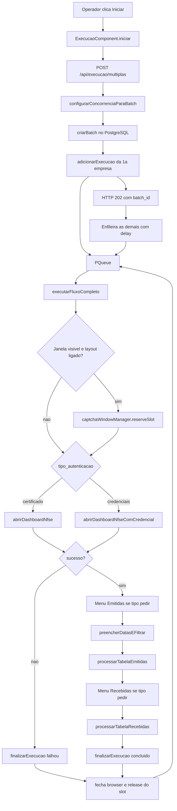
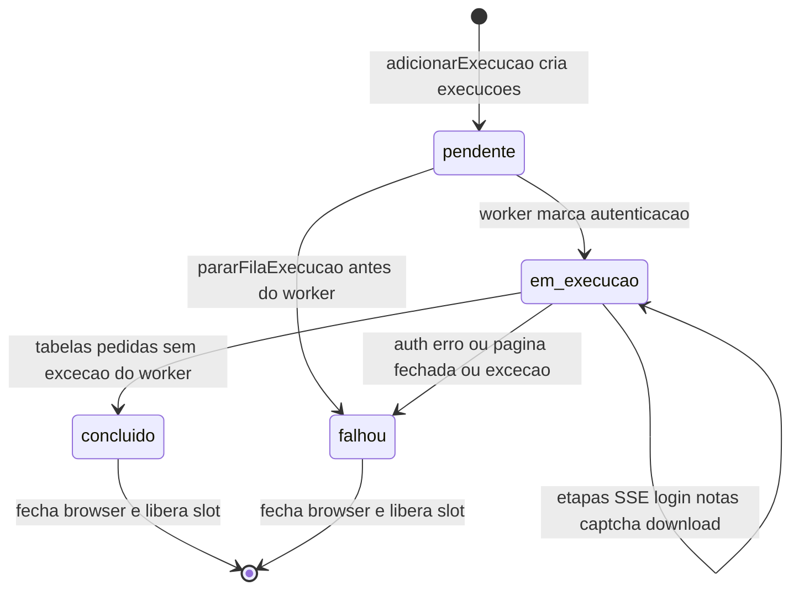
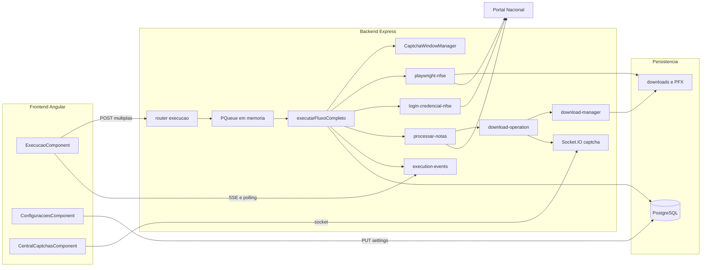
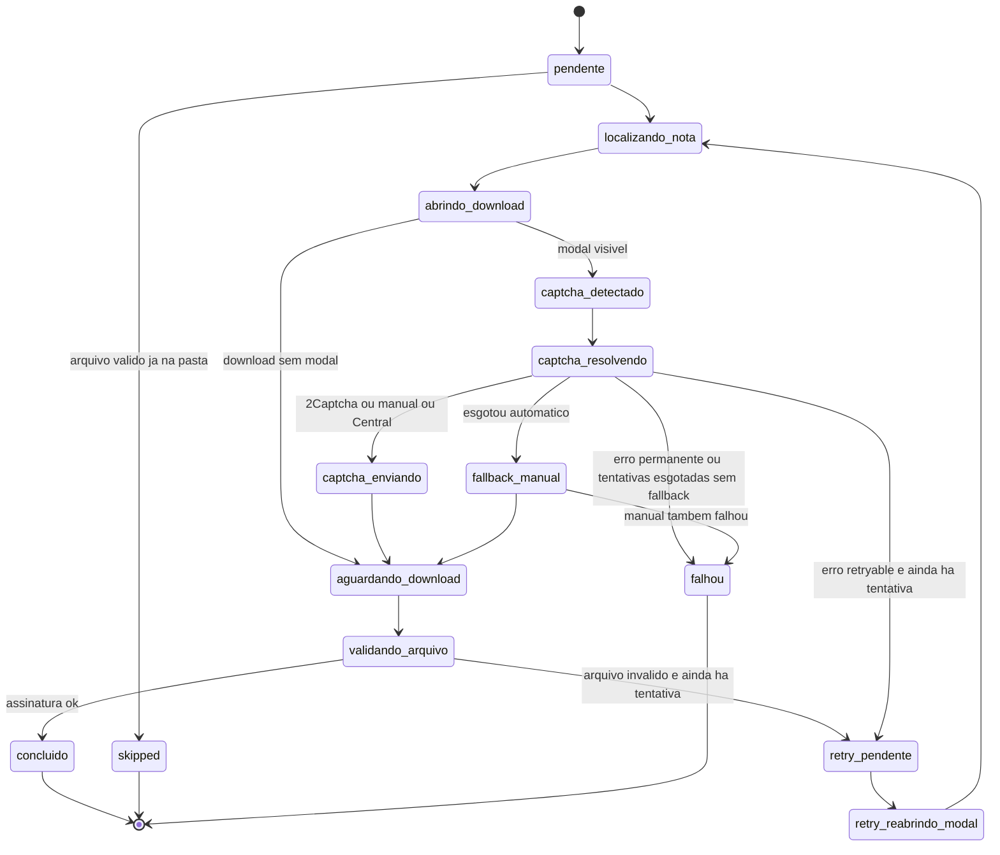

# Auditoria arquitetural do AutoNacional

Preparação para integração com o NFSExplorer. Documento baseado exclusivamente no código existente. Nenhuma automação, navegador, login, certificado, download ou banco foi executado nesta auditoria.

Quando um comportamento não está no código, o texto usa a marca **NÃO IDENTIFICADO NO CÓDIGO**.

O valor “8 navegadores” informado pelo operador **não foi lido do PostgreSQL**. O código não fixa 8 como concorrência efetiva. O teto efetivo é calculado em tempo de execução a partir de `settings`.

---

## 1. Resumo executivo

O AutoNacional é um monólito em dois processos:

- Frontend Angular 17, porta 1234 em desenvolvimento (`Frontend/package.json`, script `start`).
- Backend Node.js + Express + TypeScript, porta 4321 (`Backend/src/infrastructure/config.ts`, `PORT`).
- PostgreSQL via Prisma 7 e `@prisma/adapter-pg`.
- Automação com Playwright Chromium, um processo de browser por empresa.
- Fila em memória `p-queue`, singleton no processo do backend.
- Atualização da tela por SSE e polling HTTP a cada 2,5 s. Socket.IO existe só para a Central de CAPTCHA por screenshot.

Uma execução começa em `POST /api/execucao/multiplas`. O router enfileira empresas. Cada worker abre o próprio Chromium, autentica (certificado A1 ou credencial), percorre Emitidas e/ou Recebidas no portal `https://www.nfse.gov.br/EmissorNacional/`, baixa XML (e PDF, se pedido) por clique na linha e grava arquivos em disco. Ao terminar, fecha o browser e libera o slot visual. A próxima empresa da fila ocupa a vaga.

Os dois métodos de login compartilham o mesmo worker, a mesma fila e o mesmo processamento de notas depois da autenticação.

O CAPTCHA manual que espera o operador está no **download** de cada XML/PDF (`tratarHCaptchaManual`), com timeout padrão de 7 minutos. O login por credencial **não** espera CAPTCHA. A Central por screenshots existe, mas só entra no fluxo quando `captchaMode=MANUAL` **e** `CAPTCHA_MANUAL_USE_CENTRAL=true` (padrão `false`).

Canceladas são detectadas por ícone/título nas colunas 4 ou 5 da tabela e **não são baixadas**. Não há `data-situacao`, nem chave de 50 dígitos, nem chamada SEFIN, nem reconciliação portal × arquivos.

O ponto de integração mais estreito é o trecho de `executarFluxoCompleto` que, depois da autenticação bem-sucedida, chama `processarTabelaEmitidas` / `processarTabelaRecebidas`. O orquestrador, os slots de janela, o login por credencial e a espera manual no browser podem permanecer.

---

## 2. Inventário tecnológico

| Camada | O que o código usa |
|---|---|
| Linguagem | TypeScript no backend e no frontend |
| Runtime | Node.js `>=18` (`Backend/package.json`, `engines`) |
| API | Express 4 |
| Validação pontual | Zod no `captchaMode` do router de execução |
| Automação | Playwright 1.58, Chromium (`chromium.launch`) |
| Fila | `p-queue` 9, em memória, `autoStart: true` |
| Banco | PostgreSQL, Prisma schema `Backend/prisma/schema.prisma` |
| Tempo real da execução | SSE em `GET /api/execucao/stream/:batch_id` |
| Tempo real da Central | Socket.IO em `/socket.io` |
| Log de processo | Pino |
| Planilhas | `xlsx` no backend (importação) e no frontend (resumo Excel) |
| Certificado | PFX em buffer, `clientCertificates` do Playwright. Parser `node-forge` no cadastro |
| Storage de PFX | filesystem local ou SFTP (`ssh2`), escolhido por `CERT_STORAGE_DRIVER` |
| Senhas | AES-256-CBC em `Backend/src/infrastructure/crypto.ts`. Credenciais antigas em 3 partes usam AES-256-GCM em `Backend/src/utils/crypto.ts` |
| Frontend | Angular 17, Tailwind, Chart.js, RxJS, socket.io-client |
| Container | Docker Compose, backend com Xvfb 1920×1080 (`Backend/docker-entrypoint.sh`) |
| SO do container | Linux (flags `--no-sandbox` quando `PLAYWRIGHT_NO_SANDBOX=true`) |
| SO do operador local | NÃO IDENTIFICADO NO CÓDIGO como exigência única. O código trata Linux em container e não consulta o tamanho real do monitor |

Scripts do backend (`Backend/package.json`): `dev`, `build`, `start`, `prisma:generate`, `prisma:push`, `prisma:migrate`, `playwright:install`, `setup`, `test`, `test:smoke-db`, `tunnel:db`, `test:smoke-storage`, `typecheck`.

Scripts do frontend: `start` (`ng serve --port 1234`), `build`, `build:prod`, `test`.

Inicialização do backend: `bootstrap()` em `Backend/src/main.ts` (linhas 109–227).

1. Conecta o PostgreSQL e faz seed de `settings` se a tabela estiver vazia (`Backend/src/db/init.ts`).
2. Verifica o storage de certificados.
3. Garante diretórios de logs, temp e downloads e agenda limpeza a cada 24 h.
4. Registra `carregarCertificadoPorCnpj` como loader.
5. Sobe HTTP + Socket.IO.
6. Em SIGINT/SIGTERM chama `pararFilaExecucao(20_000)`.

Inicialização do frontend: `Frontend/src/main.ts` → `bootstrapApplication(AppComponent)`. Rotas em `Frontend/src/app/app.routes.ts`.

Playwright **não** sobe no bootstrap. O Chromium nasce dentro do worker, em `abrirDashboardNfse` ou `abrirDashboardNfseComCredencial`.

A fila nasce na carga do módulo:

```363:366:Backend/src/services/execution-service.ts
const fila = new PQueue({
  concurrency: 3,
  autoStart: true,
});
```

O valor 3 é só o estado inicial do objeto. Antes do lote, `configurarConcorrenciaParaBatch` substitui `fila.concurrency`.

---

## 3. Estrutura do projeto

```text
AutoNacional/
  docker-compose.yml              # produção: backend + frontend, Postgres externo
  docker-compose.local.yml        # desenvolvimento com Postgres próprio
  Backend/
    src/main.ts                   # entry point HTTP
    src/infrastructure/           # config, logger, socket, crypto CBC
    src/db/                       # Prisma client + seed de settings
    src/routers/execucao.ts       # producer da automação
    src/services/execution-service.ts
    src/automation/               # Playwright, download, CAPTCHA
    src/modules/                  # empresas, certificados, credenciais, imports
    src/storage/                  # PFX local ou SFTP
    src/repositories/
    prisma/schema.prisma
  Frontend/
    src/main.ts
    src/app/components/execucao/
    src/app/components/central-captchas/
    src/app/components/configuracoes/
  docs/
```

Dados fora do Git, segundo o README: certificados, downloads, logs e temp sob `/srv/data/autonacional/`. O Compose monta esses diretórios no backend.

### Componentes que participam de uma execução

| Componente | Arquivo | Responsabilidade | Quem chama | O que chama |
|---|---|---|---|---|
| API de lote | `Backend/src/routers/execucao.ts` `POST /multiplas` | Valida empresas, período, captchaMode; cria batch; enfileira | `ExecucaoComponent.iniciar` | `configurarConcorrenciaParaBatch`, `adicionarExecucao`, `criarBatch` |
| Orquestrador | `Backend/src/services/execution-service.ts` `executarFluxoCompleto` | Um worker por empresa: login, notas, fechamento | `fila.add` | Playwright, processamento de tabela, SSE, Prisma |
| Fila | `PQueue` `fila` no mesmo arquivo | Limita quantos workers rodam juntos | `adicionarExecucao` | `executarFluxoCompleto` |
| Slots visuais | `Backend/src/automation/captcha-window-manager.ts` `CaptchaWindowManager` | Posição e tamanho da janela antes do launch | `executarFluxoCompleto` | settings + `calcularLayoutCaptcha` |
| Login A1 | `Backend/src/automation/playwright-nfse.ts` `abrirDashboardNfse` | Chromium + `clientCertificates` + clique em Certificado | worker se `tipoAutenticacao === 'certificado'` | `criarContextoComCertificado`, `gotoWithRetry` |
| Login credencial | `Backend/src/automation/login-credencial-nfse.ts` `abrirDashboardNfseComCredencial` | Chromium sem certificado, preenche documento e senha | worker se `credenciais` | `chromium.launch`, `gotoWithRetry` |
| Notas | `Backend/src/automation/processar-notas-competencia.ts` | Filtro de datas, paginação, canceladas, disparo do download | worker | `executarDownloadNotaComRetry` |
| Download | `Backend/src/automation/download-operation.ts` | Clique em Download XML/DANFS-e, CAPTCHA, retry, gravação | `baixarArquivosDaLinha` | `salvarDownloadDireto` |
| Arquivos | `Backend/src/automation/download-manager.ts` | Pasta, nome, validação de assinatura, idempotência por arquivo | download-operation | filesystem |
| CAPTCHA no browser | `Backend/src/automation/hcaptcha-manual-handler.ts` `tratarHCaptchaManual` | Tab/Enter, espera token, clica Confirmar | download quando o modo cai em manual | Playwright keyboard/locator |
| Central | `manual-captcha-remote.ts` + `manual-captcha.service.ts` + Socket.IO | Screenshot e clique remoto | só com flag de Central | Socket.IO |
| Eventos | `Backend/src/services/execution-events.service.ts` | SSE do lote | worker | clientes `EventSource` |
| Tela | `Frontend/src/app/components/execucao/execucao.component.ts` | Seleção, início, progresso, Excel | operador | HTTP + SSE |

Serviços auxiliares que não dirigem o download de NFS-e: validação de credenciais (`validar-credencial-nfse.ts`, fila própria em `validacoes-service.ts`), importação de planilhas, painel de rentabilidade (`automation-metrics.service.ts`), relatórios CSV/JSON (`routers/relatorios.ts`).

---

## 4. Fluxo de execução

### Pedido

`ExecucaoComponent.iniciar` (`Frontend/src/app/components/execucao/execucao.component.ts`, linhas 697–771) envia `POST /api/execucao/multiplas` com:

- `empresas[]`: `empresa_id`, `cnpj`, `tipo_autenticacao` (`certificado` ou `credenciais`)
- `dataInicio`, `dataFim` em `DD/MM/YYYY`
- `tipo`: `emitidas` | `recebidas` | `ambas`
- `headless` (checkbox da tela, padrão `false`, linha 70)
- `baixarPdf` (padrão `true`)
- `contabilidade_id`
- `captchaMode`: `TWO_CAPTCHA` (padrão da tela, linha 76) ou `MANUAL`

O número de navegadores **não** vai nesse body. Ele já está em `settings` e é lido no backend.

### Empresas e método

A tela monta `tipo_autenticacao` a partir de `login_metodo` vindo de `GET /api/execucao/companies` (`execution-summary.service.ts`).

A regra do método está em `computeOperationalSnapshot` (`empresa-status.ts`, linhas 371–374):

- certificado utilizável (`VALID` ou `EXPIRING_SOON`) → `CERTIFICADO`
- senão, credencial com status utilizável → `CREDENCIAL`

Se os dois existem e o certificado está utilizável, o método escolhido é certificado.

O router aceita o valor enviado. `tipo_autenticacao === 'credenciais'` vira credencial; qualquer outro valor vira certificado (`execucao.ts`, linha 173).

Empresas listadas como aptas: operacional + atenção, e `listarEmpresasAptas` ainda inclui parciais (`execution-summary.service.ts`, linhas 148–170).

### Período

Datas validadas no frontend e de novo no backend (`DATA_REGEX`). Competência gravada no batch é `YYYY-MM` extraída de `dataInicio` (`execucao.ts`, linhas 192–194). Essa competência **não** vira pasta de download. A pasta usa o mês do relógio do servidor (`formatarMesExecucaoParaPasta`).

### Fila

`configurarConcorrenciaParaBatch(validos.length)` ajusta `fila.concurrency` e a resposta traz `concurrency_final`.

A primeira empresa entra na fila antes do HTTP 202. As demais entram em background com `sleep(delayMs)` entre cada `adicionarExecucao` (`execucao.ts`, linhas 203–277). `delayMs` é `settings.browserLaunchDelayMs`, fallback 150 ms no código (`execution-service.ts`, linhas 120–128). O seed do schema usa 1000 ms (`schema.prisma`, linha 103). O valor vigente no banco: **NÃO IDENTIFICADO NO CÓDIGO**.

`adicionarExecucao` (linhas 194–276):

1. Recusa se `encerrandoFila`.
2. Força `headless=false` quando `captchaMode === 'MANUAL'`.
3. Insere linha em `execucoes` com status `pendente`.
4. Guarda estado em `execucoesAtivas` (Map em memória, chave = id da empresa).
5. `fila.add(() => executarFluxoCompleto(...))`.

O browser nasce só dentro do worker.

### Autenticação até a próxima empresa

`executarFluxoCompleto` (linhas 562–1038):

1. Emite `execution:started`.
2. Marca `em_execucao` / etapa `autenticacao`.
3. Se a janela é visível e `CAPTCHA_WINDOW_LAYOUT_ENABLED` (padrão `true`), reserva slot **antes** do `chromium.launch`.
4. Credencial: `credenciaisRepo.obterPrimeiraPorEmpresa` + `descriptografarSenha` + `abrirDashboardNfseComCredencial`.
5. Certificado: `certificateLoader(cnpj)` (ou certificado já passado; o lote passa `undefined`, então sempre o loader) + `abrirDashboardNfse`.
6. Se `sucesso` é falso, lança `NFSeAutenticacaoError`.
7. Guarda `page` e `browser` em `execucoesAtivas`.
8. Aplica `minActionDelayMs` das settings.
9. Resolve pasta base com `downloadsBasePath`.
10. Emitidas se `tipo` é `ambas` ou `emitidas`: clique `li:nth-of-type(3) img`, filtro, `processarTabelaEmitidas`.
11. Recebidas se `ambas` ou `recebidas`: clique `li:nth-of-type(4) img`, filtro, `processarTabelaRecebidas`.
12. Classifica `resultadoFinal`: `SEM_MOVIMENTO`, `NOTAS_EMITIDAS`, `NOTAS_RECEBIDAS` ou `NFS_ENCONTRADAS`.
13. `finally` chama `finalizarExecucao`.

`finalizarExecucao` (linhas 464–560) é idempotente por `execucaoId`:

- cancela CAPTCHA manual pendente da Central (`cancelByExecution`)
- atualiza `execucoes` para `concluido` ou `falhou`
- emite SSE `execution:finished`
- grava métrica em `automation_executions` quando há `batchId`
- remove a empresa de `execucoesAtivas`
- fecha `page` e `browser`
- `windowSlot.release()`

A `PQueue` considera o job concluído quando a promise do worker resolve. O próximo job pendente entra na hora. O slot visual liberado acorda um waiter, se houver (`captcha-window-manager.ts`, `releaseSlot`, linhas 456–469).

Não há endpoint de parar uma empresa. `limparExecucoes` no frontend só zera o estado da tela e cancela o `EventSource` (linhas 1237–1249). O worker no backend continua.



---

## 5. Gerenciamento de navegadores

### Onde o limite é definido

| Nome | Onde | Papel |
|---|---|---|
| `settings.defaultConcurrentBrowsers` | `schema.prisma` linhas 101–102, padrão **3** | Valor que o operador configura como padrão. É o primeiro termo do mínimo |
| `settings.maxConcurrentBrowsers` | mesmo model, padrão **5** | Teto. Se o padrão for maior, o PUT de settings rejeita (`settings.ts`, linhas 137–143) |
| `fila.concurrency` | `execution-service.ts` linha 363, inicial **3** | Concorrência real da `PQueue` depois do cálculo |
| `CAPTCHA_WINDOW_LAYOUT_ENABLED` | `config.ts` linhas 140–142, padrão **true** | Se true, o mínimo também considera slots visuais |
| `getVisualSlotCapacityFromSettings` | `captcha-window-manager.ts` linhas 245–257 | `maxSlots` da grade |
| `MAX_CONCURRENCY_CAP` | `config.ts` linhas 224–227, padrão **8** | **Não é lido** por `configurarConcorrenciaParaBatch` nem por `obterLimiteConcorrencia`. Constante sem uso no fluxo |
| `QUEUE_TIMEOUT` | `config.ts` linhas 218–221 | Importado em `execution-service.ts` linha 15 e **não usado** no arquivo |
| `companyTimeoutSeconds` | settings, padrão schema 300; tela de configuração inicializa 3600 | Persistido. **NÃO IDENTIFICADO NO CÓDIGO** como timeout aplicado ao worker |
| `maxRetriesPerStep` | settings | Persistido. **NÃO IDENTIFICADO NO CÓDIGO** no fluxo Playwright. O retry de navegação é local (`gotoWithRetry` = 3, menu = 2, download = `CAPTCHA_OPERATION_MAX_ATTEMPTS`) |

Cálculo do lote (`configurarConcorrenciaParaBatch`, linhas 137–159):

```text
limite = min(defaultConcurrentBrowsers, maxConcurrentBrowsers)
se layout ligado: limite = min(limite, maxSlots visuais)
concurrency_final = max(1, min(limite, totalEmpresas))
fila.concurrency = concurrency_final
```

A tela de Configurações grava os dois inteiros via `PUT /api/settings`. A tela de Execução não envia esse número.

`maxSlots` usa `maxConcurrentBrowsers` como `maxSimultaneous` (`captcha-window-manager.ts`, linhas 248–251 e 279–284), a resolução do **preset de monitor** (`viewport-resolution.ts`) e janela fixa de **769×680** (`BROWSER_WINDOW_WIDTH`, `CAPTCHA_MIN_SLOT_HEIGHT`). O código não mede o monitor físico.

O teste `captcha-window-manager.test.ts` fixa o comportamento da grade:

- Full HD 1920×1080 e máximo 5 → **2** slots (2 colunas × 1 linha).
- QHD 2560×1440 e máximo 8 → pelo menos **6** slots.
- Ultrawide 3440×1440 e máximo 8 → **8** slots, 4 colunas × 2 linhas, largura 769.

Docker de produção sobe Xvfb em **1920×1080** (`docker-entrypoint.sh`, linha 6) e `PLAYWRIGHT_HEADLESS` padrão `true` (`docker-compose.yml`, linha 17). Com layout ligado e preset FULLHD, a fórmula limita a fila a 2 mesmo em headless, porque o corte visual ocorre em `configurarConcorrenciaParaBatch` **antes** de saber se a janela será posicionada.

O posicionamento (`reserveSlot`) só ocorre quando `!headless && CAPTCHA_WINDOW_LAYOUT_ENABLED` (`execution-service.ts`, linhas 676–692).

### O que existe e o que não existe

| Pergunta | Resposta no código |
|---|---|
| Workers | Funções async dentro de `fila.add`. Não há processo worker separado, nem classe Worker |
| Semáforo nomeado | A `PQueue` limita promises. O `CaptchaWindowManager` tem fila de waiters e `claimChain` |
| Pool de browsers reutilizável | **NÃO IDENTIFICADO NO CÓDIGO**. Cada empresa faz `chromium.launch` novo |
| BrowserContext por empresa | Um `browser.newContext` por execução, dentro daquele browser |
| Processo Chromium por empresa | Um `chromium.launch` por execução. Empresas paralelas = processos paralelos |
| Browser compartilhado | **NÃO IDENTIFICADO NO CÓDIGO** |
| userDataDir / perfil persistente | **NÃO IDENTIFICADO NO CÓDIGO** |
| Concorrência diferente para A1 e credencial | Mesma `fila` |
| CAPTCHA pendente ocupa vaga | Sim. O worker fica dentro de `tratarHCaptchaManual` ou do 2Captcha até timeout. `fila.pending` e o slot visual continuam ocupados |
| Um CAPTCHA bloqueia as outras empresas já abertas | Não. Cada worker é independente. Bloqueia só a entrada de uma nova empresa quando a concorrência está cheia |
| Pausar uma empresa | **NÃO IDENTIFICADO NO CÓDIGO** |
| Limite de memória no Node | **NÃO IDENTIFICADO NO CÓDIGO**. O Compose define `shm_size: 1gb` no serviço backend |
| Janela fechada pelo operador | `isTargetClosedError` em `executarFluxoCompleto` (linhas 977–985) grava falha com a mensagem “Navegador/página fechou durante a automação”. `finalizarExecucao` solta o slot |
| Mistura de sessão | Cada launch tem contexto novo. A1 injeta o PFX só nas origins `https://www.nfse.gov.br` e `https://certificado.nfse.gov.br` (`playwright-nfse.ts`, linhas 106–117). Credencial não registra certificado. O Map `executionStates` de download é por `executionId` (`download-operation.ts`, linhas 68–78) |

### Exemplo com o algoritmo real

Cenário que o teste já calcula, não uma distribuição inventada de CNPJs:

- `defaultConcurrentBrowsers = 8`
- `maxConcurrentBrowsers = 8`
- monitor CUSTOM 3440×1440
- `CAPTCHA_WINDOW_LAYOUT_ENABLED=true`
- 10 empresas no lote
- janelas visíveis

`maxSlots = 8`. `concurrency_final = 8`.

O producer enfileira a empresa 1 e responde 202. As empresas 2–10 entram com pausa de `browserLaunchDelayMs` entre os `fila.add`. Isso espaça o **enfileiramento**, não o launch: o launch espera vaga na `PQueue` e, no modo visível, um slot livre.

Oito workers chamam `reserveSlot` e abrem oito Chromiums nas posições da grade (769 px de largura). As duas empresas restantes ficam em `fila.size` (pendentes). Quando um worker chega ao `finally`, fecha o browser, chama `release()`, e a `PQueue` inicia o próximo job, que reserva o índice devolvido ao waiter.

Em Full HD com o mesmo máximo 8, o mesmo teste produz `maxSlots = 2`. Aí `concurrency_final` seria 2, não 8.

---

## 6. Autenticação por certificado A1

### Cadastro e guarda

`cadastrarPorCertificado` (`cadastro-certificado.service.ts`):

- lê o PFX com `parseCertificado(buffer, senha)` (`node-forge`, via `certificado.parser`)
- extrai CNPJ e razão social
- cria ou reaproveita `empresas`
- grava o arquivo no storage no caminho `contabilidade/{id}/empresa/{cnpj}/certs/{timestamp}.pfx` ou `empresa/{cnpj}/certs/{timestamp}.pfx` (linhas 21–30)
- persiste em `certificados_digitais`: caminho relativo em `arquivo`, senha em `senhaCriptografada`, validade em `dataValidade`

Storage (`storage/index.ts`):

- `CERT_STORAGE_DRIVER=sftp` → `SftpCertificateStorage`
- caso contrário → `LocalCertificateStorage` em `CERT_STORAGE_PATH` (padrão `/srv/data/autonacional/certificados`, `config.ts` linha 23)

Senha: `encryptPassword` / `decryptPassword`, AES-256-CBC, chave derivada de `CRYPTO_KEY` ou `APP_CRED_KEY` (`infrastructure/crypto.ts`). O PFX em si não é criptografado de novo; o arquivo é o binário enviado.

Conversão PEM/P12 além do parse no cadastro e do buffer PFX entregue ao Playwright: **NÃO IDENTIFICADO NO CÓDIGO**.

### Uso no Playwright

`carregarCertificadoPorCnpj` (`certificate-loader.ts`, linhas 24–78) lê o buffer e descriptografa a senha em memória. O retorno é `{ pfx, passphrase }`.

`criarContextoComCertificado` (`playwright-nfse.ts`, linhas 68–123):

- `chromium.launch({ headless, args })`
- `browser.newContext({ clientCertificates, acceptDownloads: true, ignoreHTTPSErrors: true, viewport, userAgent macOS/Chrome 120 })`
- certificado registrado nas duas origins do portal
- zoom via `aplicarZoomPaginaNoContexto` (`BROWSER_PAGE_ZOOM`, padrão 1.0; se o env for inválido, cai para 0.8 — `config.ts` linhas 67–71)

Uma page por contexto.

### Portal e sucesso

URL: `https://www.nfse.gov.br/EmissorNacional/`.

`gotoWithRetry` (até 3 tentativas, backoff 1500 ms × tentativa) para erros de navegação.retryáveis. Página fechada não retenta (`playwright-nav.ts`, linhas 192–236).

Seletores de login: `button:has-text("Certificado")`, `a:has-text("Certificado")`, `#btnCertificado`, `.btn-certificado`.

Seletores de área logada: textos Dashboard, Painel, Meus dados; hrefs de Dashboard e MeusDados; `.dashboard`, `#dashboard`; `li:nth-of-type(3) img`; `#datainicio` (`playwright-nfse.ts`, linhas 183–201).

Se acha o botão e ainda não acha área logada, clica uma vez e espera URL ou seletor. Sucesso final (linhas 349–368) se qualquer um for verdadeiro:

- seletor de autenticado visível
- texto do body com “meus dados”, “dashboard”, “notas emitidas” ou “notas recebidas”
- URL com dashboard/meusdados, ou URL de `emisornacional` sem `login`

Confirmação do CNPJ autenticado contra o CNPJ do certificado: **NÃO IDENTIFICADO NO CÓDIGO**.

### Retentativa, validade, reuso

- Retry do login A1 inteiro: **NÃO IDENTIFICADO NO CÓDIGO**. Falha encerra a empresa.
- Validade: `computeCertificateStatus` impede elegibilidade se `EXPIRED` e não houver credencial utilizável. Durante o worker, o loader não consulta `dataValidade`. Certificado vencido que mesmo assim for chamado chega ao portal e falha na heurística de sucesso, ou o portal recusa o handshake. Mensagem específica de expiração no Playwright: **NÃO IDENTIFICADO NO CÓDIGO**.
- Reuso entre execuções: o arquivo no storage permanece. Cada execução lê de novo e cria browser novo. Contexto não é cacheado.
- O browser permanece aberto durante Emitidas, Recebidas e downloads. Fecha em `finalizarExecucao`.
- Processo exclusivo de A1: o mesmo worker. A diferença é `clientCertificates` e os seletores de clique em Certificado.
- Depois do `sucesso`, o processamento de notas é o mesmo da credencial.

---

## 7. Autenticação por credenciais

### Cadastro

Modelo `Credencial` (`schema.prisma`, linhas 56–72): `empresaId`, `tipo` (`CNPJ_SENHA` ou `CPF_SENHA`), `usuario`, `senhaCriptografada`, `status` (`NAO_TESTADO`, `OK`, `INVALIDA`, `ERRO_VALIDACAO`, `BLOQUEADA`), `ultimoTesteEm`, `ultimaMensagem`.

`descriptografarSenha` (`repositories/credenciais.ts`, linhas 113–121): se a string tem 3 partes, AES-256-GCM; senão, AES-256-CBC. Gravações novas usam `encryptPassword` (CBC).

O worker usa `obterPrimeiraPorEmpresa`. Ausência de credencial falha a empresa com mensagem explícita (`execution-service.ts`, linhas 698–707).

### Browser e campos

`abrirDashboardNfseComCredencial` (`login-credencial-nfse.ts`):

- `headless` padrão do parâmetro é `true` se omitido (linha 44). No lote, o worker passa o headless do pedido, e modo MANUAL força `false`.
- `chromium.launch` sem `clientCertificates`
- userAgent Windows/Chrome 120 (diferente do A1)
- args incluem `--disable-web-security` e `--disable-features=IsolateOrigins,site-per-process`
- viewport do slot, ou fallback 769×680
- `goto` na mesma `BASE_URL`
- documento: primeiro seletor que existir entre `input[name="cnpj"]`, `usuario`, ids, placeholders, ou `input[type="text"]`
- senha: `input[name="senha"]`, `#senha`, `input[type="password"]`, placeholder Senha
- `fill` do documento só com dígitos e da senha
- clique em `button:has-text("Entrar")`, “Acessar”, `input[type="submit"]`, `.btn-login` ou `#btnLogin`
- espera fixa de **5000 ms** (linha 159)

Sucesso se a URL contém dashboard, painel, `/home` ou `/principal`, ou um seletor de dashboard/painel está visível, ou o campo de documento sumiu e não há texto de falha.

Textos de falha (linhas 165–171): “senha incorreta”, “credencial inválida”, “usuário ou senha inválidos”, “acesso negado”, “dados incorretos”, “tente novamente”.

### CAPTCHA neste login

Detecção de hCaptcha, espera de operador ou timeout de CAPTCHA dentro de `abrirDashboardNfseComCredencial`: **NÃO IDENTIFICADO NO CÓDIGO**.

Se o portal exigir CAPTCHA na tela de Entrar e o operador levar mais que a espera de 5 s mais as checagens síncronas, a função lança “Não foi possível confirmar acesso ao dashboard após login” e a empresa falha. Não há loop de nova tentativa de login.

A espera longa do operador está no download, descrita na seção 8. Ela vale para certificado e para credencial, porque os dois caem em `processarTabela*`.

Sessão expirada no meio da navegação: **NÃO IDENTIFICADO NO CÓDIGO** como detecção específica. Vira erro de seletor, timeout ou página fechada, e a empresa falha.

Várias janelas: cada credencial tem o próprio browser e o próprio slot. O preenchimento usa a `page` daquela execução.

Download de XML depois do login: o mesmo `baixarArquivosDaLinha`. Diferença de download entre A1 e credencial: **NÃO IDENTIFICADO NO CÓDIGO**.

Validação avulsa de credencial (tela de empresas, não o lote) está em `validar-credencial-nfse.ts` e na fila de `validacoes-service.ts`, com o mesmo limite de concorrência das settings.

---

## 8. CAPTCHA manual no navegador

Este é o caminho que mantém a janela aberta e espera alguém resolver o desafio nela.

Gatilho: durante o download, depois do clique em “Download XML” ou “Download DANFS-e”. `tentarResolverCaptchaSeNecessario` (`download-operation.ts`, linhas 497–580) espera o seletor `#btnSubmitHCaptcha` ficar visível, em paralelo com o evento `download`. Se o arquivo começa a baixar sem modal, o CAPTCHA é ignorado.

Dois interruptores se cruzam:

1. `captchaMode` do lote (`TWO_CAPTCHA` ou `MANUAL`), vindo da tela.
2. `CAPTCHA_MODE` do ambiente (`auto`, `manual` ou `auto_manual`). Padrão **`auto_manual`** (`config.ts`, linhas 109–111).

Se o lote está em `MANUAL` (linhas 521–543):

- com `resolverCaptchaCentral` injetado → Central
- senão → `aguardarResolucaoManual` → `tratarHCaptchaManual`

`resolverCaptchaCentral` só é injetado quando as três condições valem (`processar-notas-competencia.ts`, linhas 558–564):

- `captchaMode === 'MANUAL'`
- `CAPTCHA_MANUAL_USE_CENTRAL === true` (padrão **false**, `config.ts` linhas 132–133)
- existe `batchId`

Com o padrão do ambiente, lote `MANUAL` resolve **no navegador**, apesar do rótulo da tela “Manual — Central de Captchas” (`execucao.component.html`, linha 196).

Se o lote está em `TWO_CAPTCHA` (padrão da tela):

- `CAPTCHA_MODE=auto` ou `auto_manual`, e a execução ainda não estourou `CAPTCHA_CONSECUTIVE_FAILURE_LIMIT` (padrão 3): chama 2Captcha
- `CAPTCHA_MODE=manual`, ou o limite de falhas estourou, ou o retry pede `forceManual`: cai em `tratarHCaptchaManual`
- depois de esgotar tentativas automáticas, se `CAPTCHA_OPERATION_FALLBACK_MANUAL` (padrão true) e `CAPTCHA_MODE !== 'auto'`, há outro fallback manual daquela operação (linhas 806–883)

`tratarHCaptchaManual` (`hcaptcha-manual-handler.ts`, linhas 230–399):

1. Confirma o modal `#btnSubmitHCaptcha`.
2. Espera 2500 ms (`MODAL_ANIMATION_DELAY_MS`).
3. Envia Tab, 500 ms, Tab, 500 ms, Enter (`abrirDesafioComTeclado`). O comentário do arquivo diz que isso abre o desafio. O código não clica em imagens.
4. Faz polling de 1 s até `CAPTCHA_MANUAL_TIMEOUT_MS` (padrão **420000**, 7 min).
5. Considera resolvido se o modal sumir, ou se `textarea` `h-captcha-response` / `g-recaptcha-response` tiver mais de 20 caracteres e o clique em Confirmar fechar o modal.
6. Confirmar: `#btnSubmitHCaptcha`, XPath do mesmo id, ou XPath absoluto `body/div[4]/.../button[1]`.
7. Timeout devolve status `TIMEOUT`. `aguardarResolucaoManual` transforma isso em `CaptchaError` `ERROR_CAPTCHA_UNSOLVABLE`, que é retryable.

Enquanto espera, a empresa permanece `em_execucao`. A tela marca `AGUARDANDO_CAPTCHA` quando o estágio SSE é `captcha_aguardando`, `captcha_aguardando_central` ou `captcha_fallback_manual` (`execucao.component.ts`, linhas 933–938 e 1100–1105). O card “Executando (navegadores abertos)” inclui esse status (linhas 468–472).

Se o operador demora além de 7 min, a operação entra na lógica de retry (padrão `CAPTCHA_OPERATION_MAX_ATTEMPTS=2`) ou no fallback, e pode falhar aquele XML sem derrubar as outras empresas. A falha de um arquivo é `logger.warn` em `baixarArquivosDaLinha` (linhas 586–591). A linha ainda incrementa `qtdBaixadas` (ver seção 11).

CAPTCHA recusado (token não aparece, Confirmar falha, modal continua): status `CONFIRM_FAILED` ou timeout, classificado como retryable. Não há contador separado de “recusa do portal”.

O handler declara que não move a janela. A posição veio do slot no launch.

---

## 9. CAPTCHA por screenshots

Funcionalidade presente e opcional.

| Peça | Arquivo | Função |
|---|---|---|
| Captura JPEG do viewport | `manual-captcha-remote.ts` `captureViewportFrame` linhas 34–65 | `page.screenshot` jpeg quality 72, `scale: 'css'`, `fullPage: false` |
| Loop remoto | `resolverCaptchaPorCliquesRemotos` | publica frames, aplica clique normalizado com `page.mouse.click` |
| Estado em memória | `services/manual-captcha.service.ts` | pendências por batch, timeout `MANUAL_CAPTCHA_TIMEOUT_MS` padrão 120000 |
| Transporte | `infrastructure/socket.ts` | eventos `captcha:join-batch`, `captcha:click`, `captcha:refresh`, `captcha:confirm`, `captcha:resolve`, `captcha:skip` |
| Tela | `central-captchas.component.ts`, rota `execucao/captchas/:batchId` | abre em outra guia se `captchaMode===MANUAL` e há `batchId` |
| 2Captcha | `captcha-solver.ts`, `captcha/two-captcha.provider.ts` | API v2 ou v1, independente da Central |
| Diagnóstico | `captcha-diagnostic.ts`, `captcha-report.ts` | JSON e relatório local quando `CAPTCHA_DEBUG` |

A Central não é obrigatória. Com `CAPTCHA_MANUAL_USE_CENTRAL` no padrão `false`, `processarTabela*` não injeta `resolverCaptchaCentral`. O download e o CAPTCHA no browser seguem.

Quem depende dela de fato: a rota da Central, o cliente Socket.IO (`captcha-central.service.ts`) e o ramo explícito acima. O SSE de execução não depende do Socket.IO (`socket.ts`, comentário das linhas 1–3).

Código compartilhado com a espera no browser: o seletor `#btnSubmitHCaptcha` (`hcaptcha-page.ts` e o handler manual). A detecção “apareceu modal?” está em `download-operation.ts` e é comum aos três destinos (2Captcha, browser, Central).

Desligar a Central sem apagar arquivos: manter a flag `false` e não escolher um modo que a injete. Apagar os arquivos exigiria conferir imports; isso não foi feito nesta auditoria e não deve ser feito como parte dela.

---

## 10. Descoberta de notas no portal

Tudo é DOM via Playwright. Não há API de listagem.

### Acesso

- Emitidas: `page.locator('li:nth-of-type(3) img').nth(0)` e `clicarMenuNotasEAguardar` até URL contendo `/Notas/Emitidas` e `#datainicio` visível. Uma retentativa de clique (`playwright-nav.ts`, linhas 138–175).
- Recebidas: `li:nth-of-type(4) img`, URL `/Notas/Recebidas`.

### Período

`preencherDatasEFiltrar` (`processar-notas-competencia.ts`, linhas 766–787):

- `#datainicio` e `#datafim` via XPath `//*[@id="datainicio"]` e `//*[@id="datafim"]`
- `fill` com a string `DD/MM/YYYY` recebida
- clique em `//*[@id="searchbar"]/form/div[2]/div[2]/div[2]/button`
- espera estabilizar até 15 s

Não há segundo filtro por competência do XML.

### Paginação e vazio

`clicarBotaoProximaPagina` (linhas 433–458): `i.fa-angle-right` ou o `<a>` pai. Se a classe do ancestral `li` contém `disabled`, para. Depois espera `table tbody tr`.

`verificarSemRegistros` (linhas 463–483): XPath `/html/body/div[1]/span`, `span.sem-registros`, ou texto “Nenhum registro encontrado”.

Loop: espera a tabela, conta `table tbody tr`, processa cada linha, avança. Zero linhas encerra. Não há leitura de “página X de Y”. Não há comparação de conteúdo entre páginas para detectar paginação que não andou.

### Chave, situação, cancelada

`extrairIdentificadorDaLinha` (`download-operation.ts`, linhas 187–230):

- junta o texto das `td` e procura `\d{44}`
- senão procura `\d{44}` no HTML da linha
- senão monta um composto com o número da nota e trechos das células, ou `row-{timestamp}`

Chave de 50 dígitos: **NÃO IDENTIFICADO NO CÓDIGO**. Um número de 50 dígitos não casa com `\d{44}` como identificador único; o fallback é texto composto.

`data-situacao`: **NÃO IDENTIFICADO NO CÓDIGO**.

Cancelada (`verificarNotaCancelada`, linhas 488–506): nas `td` de índice 4 e 5, se existir `img` cujo `src` ou `title` / `data-original-title` contém a substring `cancelada`. Não olha ícone por classe CSS além disso.

Nota cancelada não entra em `baixarArquivosDaLinha`. Incrementa `qtdCanceladas`.

Duplicidade na descoberta: **NÃO IDENTIFICADO NO CÓDIGO** um conjunto de chaves já vistas. A idempotência posterior é por arquivo já existente na pasta (seção 11).

Completude (todas as páginas, todas as chaves): **NÃO IDENTIFICADO NO CÓDIGO**. O fim é “botão próxima ausente ou disabled” ou tabela vazia.

Erro de navegação no menu: a segunda tentativa relança. No worker, isso falha a empresa inteira. Erro numa linha é engolido com `logger.debug` (`processarTabelaEmitidas`, linhas 686–688) e o loop segue.

Retorno: `{ qtd_baixadas, qtd_canceladas, sem_registros, encontrou_notas }`.

### Diferença em relação ao comportamento descrito do NFSExplorer

| NFSExplorer (contexto informado) | AutoNacional no código |
|---|---|
| Chave de 50 dígitos | Somente `\d{44}` ou texto composto |
| Classificação por `data-situacao` | Ícone nas colunas 4 e 5 com texto `cancelada` |
| Cancelada permanece no inventário e sai do pacote contábil | Cancelada é contada e não é baixada. Não há inventário de chaves |
| `dCompet` não exclui a nota | O AutoNacional não lê `dCompet`. Quem entra é o que a tabela do portal mostrou depois do filtro de datas |
| Reconciliação portal × XML | **NÃO IDENTIFICADO NO CÓDIGO** |
| SEFIN mTLS | **NÃO IDENTIFICADO NO CÓDIGO** |

---

## 11. Downloads

`baixarArquivoDireto` (`download-manager.ts`, linhas 298–359) faz HTTP com `page.request.get` no `href`. **Nenhum caller** no `Backend/src` a invoca. O caminho usado é clique + evento `download`.

`executarTentativaDeDownload` (`download-operation.ts`, linhas 582–628):

1. Abre o menu da linha. Coluna de ações: índice 6 em Emitidas, 5 em Recebidas (`abrirMenuEObterLink`, linhas 470–495).
2. Link `getByRole('link', { name: 'Download XML' })` ou, se count 0, `a:has-text("XML")` dentro de `.menu-suspenso-tabela`.
3. PDF: “Download DANFS-e” ou `a:has-text("DANFS-e")`.
4. `page.waitForEvent('download')` e `link.click`.
5. Resolve CAPTCHA se o modal aparecer.
6. `salvarDownloadDireto`.
7. `validarArquivoBaixado`: tamanho > 0; PDF começa com `%PDF`; XML não pode parecer HTML.

Não há download em lote nem ZIP dos XMLs. **NÃO IDENTIFICADO NO CÓDIGO** empacotamento ZIP.

Fila interna por empresa: sequencial na mesma page. Uma operação (um arquivo) por vez, com retry daquela operação. Não há segunda `PQueue` de downloads.

Retry (`executarDownloadNotaComRetry`, linhas 674–905):

- se já existe arquivo válido com o prefixo do número na pasta, status `skipped` e não clica
- até `CAPTCHA_OPERATION_MAX_ATTEMPTS` (padrão 2)
- erro retryable fecha `#btnLimpar`, espera `CAPTCHA_OPERATION_RETRY_DELAY_MS` (padrão 4000) e relocaliza a linha pela chave
- erro de arquivo inválido apaga o arquivo e pode retentar
- página/browser fechado é permanente
- configuração do 2Captcha (saldo, chave) é permanente

Nome (`gerarNomeArquivo`): `suggestedFilename` do browser se parecer nome válido; senão prefixo `numeroNota_` + extensão. Prefixo vem do primeiro texto com dígito entre as 4 primeiras células, sanitizado, no máximo 50 caracteres (`acharNumeroNota`).

Pastas (`montarCaminhoCompleto`, linhas 155–172):

```text
{downloadsBasePath}/{contabilidade}/{mês por extenso}-{ano}/{empresa}/{Emitidas|Recebidas}/
```

Exemplo de mês: `janeiro-2026`, calculado com `new Date()` no worker, não com `dataInicio`. `downloadsPattern` `{cnpj}/{ano}/{mes}` existe nas settings e numa prévia de caminho em `routers/settings.ts` (`resolveDownloadsPattern`). `montarCaminhoCompleto` não usa esse pattern.

Colisão entre empresas: segmentos sanitizados de contabilidade e razão social (`sanitizarNomePasta`). Duas razões sociais que sanitizam igual compartilhariam pasta. Isolamento por CNPJ no caminho do XML: **NÃO IDENTIFICADO NO CÓDIGO**. O CNPJ não entra em `montarCaminhoCompleto`.

Arquivo existente: `localizarArquivoExistenteValido` lista o diretório e aceita o primeiro arquivo da extensão cujo nome contém os 20 primeiros caracteres do prefixo. Não compara hash nem chave de 44 dígitos.

Fim da empresa: as tabelas pedidas terminaram sem exceção não tratada no worker. Falha de um XML não marca a empresa como `falhou`. `qtd_baixadas` incrementa para cada linha não cancelada **depois** de `baixarArquivosDaLinha`, mesmo quando o XML retornou `success: false` (`processar-notas-competencia.ts`, linhas 670–684). A contagem é de linhas processadas como vigentes, não de arquivos validados.

Reconciliação “linhas da tabela = XMLs no disco”: **NÃO IDENTIFICADO NO CÓDIGO**.

Ponto futuro para SEFIN: substituir `executarDownloadNotaComRetry` (ou `baixarArquivosDaLinha`) mantendo a page autenticada só para descobrir chaves. O HTTP direto já esboçado em `baixarArquivoDireto` não é o SEFIN e não está ligado.

---

## 12. Cancelamentos

- Classificação **antes** do download, na linha (`verificarNotaValida`).
- Cancelada não gera XML nem PDF.
- Entra em `qtdNotasCanceladas` somando emitidas e recebidas.
- Vai no SSE `execution:counts` e `execution:finished` (`qtd_canceladas`).
- Vai em `automation_executions.qtdCanceladas` (`persistirExecution`).
- A tabela `execucoes` **não tem** coluna de canceladas (`schema.prisma`, linhas 149–172). O fallback de status no banco devolve `qtd_notas_canceladas: 0` (`execution-service.ts`, linha 327).
- Evento fiscal de cancelamento (XML de evento): **NÃO IDENTIFICADO NO CÓDIGO**.
- Exclusão de XML já baixado se a nota cancelar depois: **NÃO IDENTIFICADO NO CÓDIGO**.
- Relatório só de canceladas: **NÃO IDENTIFICADO NO CÓDIGO**. O Excel da tela inclui a coluna “NF Canceladas” com o valor em memória da linha (`execucao.component.ts`, por volta da linha 1433). O resumo `GET /api/relatorios/execucoes/resumo` usa só emitidas e recebidas de `execucoes`.

Totais de resultado da empresa (`SEM_MOVIMENTO`, etc.) usam `qtdNotasEmitidas` e `qtdNotasRecebidas`, que são as linhas não canceladas processadas. Canceladas não entram nesses rótulos.

Interação com exportação: o Excel do frontend exporta o que a grade tem no momento. Não reabre os XMLs.

---

## 13. Armazenamento

### Banco

PostgreSQL. Tabelas do schema:

| Tabela | Uso na automação |
|---|---|
| `contabilidades` | Dono das empresas e nome da pasta |
| `empresas` | CNPJ, razão social, vínculo |
| `credenciais` | Login alternativo |
| `certificados_digitais` | Caminho do PFX, senha cifrada, validade |
| `settings` | Concorrência, caminhos, viewport, delays |
| `execucoes` | Uma linha por empresa enfileirada: status, etapa, contagens de emitidas/recebidas, resultado |
| `execucao_batch_log` e `execucao_log_batch` / `execucao_log_item` | Log gravado quando o operador salva o log na tela |
| `automation_execution_batches` / `automation_executions` | Métricas do painel de rentabilidade, inclusive canceladas |

Não há tabela de notas, chaves, checkpoints ou arquivos.

### Disco

- PFX: `CERT_STORAGE_PATH` ou SFTP
- XML/PDF: `settings.downloadsBasePath`, padrão `./downloads`. No Compose, `/srv/data/autonacional/downloads` → `/app/downloads`
- Logs de processo: `logsPath`, padrão `./logs`
- Temp: `tempPath`
- Limpeza automática: `limparDiretorioPorIdade` em logs e temp, retenção `logRetentionDays` (padrão 30), no bootstrap e a cada 24 h (`main.ts`, linhas 143–162). O comentário de `runtime-cleanup.ts` diz que downloads de XML/PDF não entram nessa limpeza
- Screenshots de erro da setting `saveErrorScreenshots`: a flag é salva. Uso no fluxo de download: **NÃO IDENTIFICADO NO CÓDIGO**. Há screenshot de diagnóstico de CAPTCHA quando o debug está ligado
- `generatePdfReport`: flag salva. Geração de PDF de relatório no backend: **NÃO IDENTIFICADO NO CÓDIGO**
- ZIP: **NÃO IDENTIFICADO NO CÓDIGO**

Histórico por empresa: linhas em `execucoes` e `automation_executions`. Histórico por período de pasta: o diretório usa o mês da execução, não a competência consultada. Duas consultas do mesmo mês calendário escrevem na mesma pasta da empresa.

---

## 14. Filas, estados e retomada

| Pergunta | Resposta |
|---|---|
| Fila persistente de jobs | **NÃO IDENTIFICADO NO CÓDIGO**. `PQueue` morre com o processo |
| Estado em memória | `execucoesAtivas`, `finalizadosIds`, `executionStates` de download, clientes SSE, pendências de CAPTCHA |
| Sobrevive a reinício | Linhas `execucoes` e métricas sim. Jobs pendentes ou browser aberto não. Não há reidratação da fila no `bootstrap` |
| Checkpoint por empresa | A linha `execucoes` e, no fim, `automation_executions`. Não há “página 3, nota 12” |
| Checkpoint por período | **NÃO IDENTIFICADO NO CÓDIGO** |
| Retomada automática do lote | **NÃO IDENTIFICADO NO CÓDIGO** |
| Retomada manual | Rodar de novo. Arquivo já válido com o prefixo é pulado |
| Falha parcial de XML | Empresa pode terminar `concluido` com contagem de linhas maior que arquivos bons |
| Empresa finalizada | `finalizarExecucao` com `concluido` ou `falhou`. Status no banco: `pendente`, `em_execucao`, `concluido`, `falhou` |
| Erros contados | `resultadoFinal=ERRO` na falha da empresa. Métrica `status=ERRO`. Não há contador de XMLs falhos |
| Idempotência de arquivo | `localizarArquivoExistenteValido` |
| Job duplicado da mesma empresa | A chave do Map é o id da empresa. Um segundo `adicionarExecucao` substitui o estado em memória enquanto dois jobs podem estar na fila. **NÃO IDENTIFICADO NO CÓDIGO** uma trava “já está na fila” |
| Parar | `pararFilaExecucao` só no SIGINT/SIGTERM (`main.ts`, linhas 181–216): pausa a fila, `clear` dos jobs não iniciados, marca pendentes como `falhou`, fecha pages/browsers das que estão no Map, espera idle ou 20 s. Botão Parar na interface: **NÃO IDENTIFICADO NO CÓDIGO** |
| Fechar o aplicativo | O mesmo shutdown, com teto de 30 s e `process.exit` |
| Browser travado | Sem `companyTimeoutSeconds` aplicado ao worker. Timeouts locais: navegação `PLAYWRIGHT_TIMEOUT` 60 s, CAPTCHA manual 7 min, download `DOWNLOAD_TIMEOUT_MS` 50 s mais folga do CAPTCHA (`download-operation.ts`, linhas 48–50 e 593–595) |



Estados da operação de arquivo, no objeto em memória `DownloadOperationContext.status` (`download-operation-types.ts`, linhas 12–27): `pendente`, `localizando_nota`, `abrindo_download`, `captcha_detectado`, `captcha_resolvendo`, `captcha_token_recebido`, `captcha_enviando`, `aguardando_download`, `validando_arquivo`, `concluido`, `retry_pendente`, `retry_reabrindo_modal`, `fallback_manual`, `falhou`, `skipped`. Eles não são persistidos.

Estados da grade: `FILA`, `EM_EXECUCAO`, `AGUARDANDO_CAPTCHA`, `OK`, `ERRO`. São tradução de frontend, não colunas do banco.

---

## 15. Interface

Tela principal da automação: rota `/execucao`, `ExecucaoComponent`.

- Contabilidade, modal de empresas aptas, datas, tipo de nota, PDF, headless, modo de CAPTCHA.
- Navegadores simultâneos: rota `/configuracoes`, não na execução.
- Iniciar: botão que chama `iniciar()`. Não há pausa nem cancelamento de worker.
- Limpar: só a tela.
- Histórico operacional do lote: tabela ao vivo. Log persistido: `salvarLog` → API de logs (`execucao_log_*`). Rentabilidade: rota `/rentabilidade` lendo métricas.
- Progresso: SSE + polling de 2500 ms em `GET /api/execucao/batch/:batch_id/status`.
- Contagens na linha: emitidas, recebidas, canceladas (enquanto o SSE ou o status em memória as mandam).
- Central: botão “Abrir Central de Captchas” se modo MANUAL e há batch. Abre `/execucao/captchas/:batchId`.
- Exportação: Excel local no browser (`gerarResumo` / `gerarExcelResumo`) e CSV/JSON em `/api/relatorios/execucoes/resumo`.

Atualização:

| Canal | Uso |
|---|---|
| SSE `EventSource` | `/api/execucao/stream/:batch_id`. Eventos `started`, `stage`, `counts`, `finished`, `login_ready` |
| Polling 2,5 s | Status batch, inclusive depois que a empresa sai da memória e o fallback lê `execucoes` |
| Socket.IO | Somente Central de CAPTCHA |
| IPC | **NÃO IDENTIFICADO NO CÓDIGO** |

Indicadores novos do NFSExplorer (inventário, vigentes, reconciliados, exportados) cabem na grade atual se o SSE `execution:counts` ganhar campos e a linha do frontend os mostrar. A tabela `execucoes` não tem essas colunas; `automation_executions` tem emitidas, recebidas e canceladas. Persistir inventário exigiria coluna nova ou só memória+SSE. Não exige redesenho de rotas.

---

## 16. Dependências e acoplamentos

| Componente | Classe | Motivo |
|---|---|---|
| `execution-service.ts` orquestrador | ALTO ACOPLAMENTO | Conhece login A1, login credencial, menus `li:nth-of-type`, filtro, tabelas, SSE, Prisma, slots e loader de certificado |
| `processar-notas-competencia.ts` | ALTO ACOPLAMENTO | Seletores do portal, cancelamento por ícone, download, três estratégias de CAPTCHA e variável global `_minActionDelayMs` |
| `download-operation.ts` | ALTO ACOPLAMENTO | Menu suspenso, texto “Download XML”, modal `#btnSubmitHCaptcha`, filesystem e estado em Map |
| `playwright-nfse.ts` / `login-credencial-nfse.ts` | MÉDIO ACOPLAMENTO | Isolados atrás de `ResultadoAutenticacao`, mas os seletores são do portal e o browser sai aberto para o orquestrador |
| `captcha-window-manager.ts` | BAIXO ACOPLAMENTO | Não sabe de NFS-e. Depende de settings e é singleton |
| `download-manager.ts` `montarCaminhoCompleto` | BAIXO ACOPLAMENTO | Função pura de caminho, já desacoplada do browser. `baixarArquivoDireto` está solto, sem caller |
| `PQueue` + settings de concorrência | BAIXO ACOPLAMENTO | Não sabe se o job é A1 ou credencial |
| SSE `execution-events.service.ts` | BAIXO ACOPLAMENTO | Só fan-out de JSON. O formato dos eventos está acoplado à tela |
| Central Socket.IO | BAIXO ACOPLAMENTO | Flag default desligada. Pode ficar de legado |
| `empresa-status.ts` | BAIXO ACOPLAMENTO | Decide método antes da fila. Não abre browser |
| Prisma `execucoes` | MÉDIO ACOPLAMENTO | Status genérico. Contagem de canceladas não cabe na tabela, então a UI e as métricas divergem no fallback |

Dependência circular de módulos: **NÃO IDENTIFICADO NO CÓDIGO** no fluxo de execução. Há acoplamento prático: o orquestrador importa os dois logins e o processador; o processador importa o download; o download importa o CAPTCHA.

Estado global: `fila`, `execucoesAtivas`, `finalizadosIds`, `certificateLoader`, `captchaWindowManager`, `_minActionDelayMs`, `_downloadsBasePath`, `executionStates`.

O download está acoplado ao browser (clique). O caminho em disco está acoplado ao nome da contabilidade e ao mês do relógio, não ao CNPJ nem à competência consultada.

Ordem fixa: autenticar → emitidas → recebidas → fechar. Recebidas não começam em paralelo com emitidas na mesma empresa.

---

## 17. Arquitetura atual



---

## 18. Máquina de estados

A da seção 14 é a da empresa no banco e no worker. A da operação de arquivo:



---

## 19. Matriz de reaproveitamento

| Componente atual | Arquivo | Responsabilidade | Reaproveitar? | Alteração necessária | Risco |
|---|---|---|---|---|---|
| Tela de execução | `Frontend/.../execucao.component.ts` | Início, SSE, polling, Excel | REUTILIZAR COM ADAPTAÇÃO | Campos novos só se os counts SSE forem estendidos | Médio: fallback do banco zera canceladas |
| Settings de concorrência | `schema settings` + `configurarConcorrenciaParaBatch` | Teto de browsers | REUTILIZAR SEM ALTERAÇÃO | Nenhuma para manter o limite | Baixo |
| Slots de janela | `captcha-window-manager.ts` | Grade 769 px | REUTILIZAR SEM ALTERAÇÃO | Nenhuma enquanto o login continuar no Chromium visível | Médio em monitor Full HD: a grade corta para 2 |
| Fila `PQueue` | `execution-service.ts` | Um worker por empresa | REUTILIZAR SEM ALTERAÇÃO | Nenhuma | Baixo |
| Login A1 | `playwright-nfse.ts` | mTLS no browser e sessão | REUTILIZAR SEM ALTERAÇÃO | Nenhuma na primeira etapa | Médio: sucesso não confere CNPJ |
| Loader de PFX | `certificate-loader.ts` | Buffer + senha em memória | REUTILIZAR SEM ALTERAÇÃO | O motor SEFIN pode receber o mesmo `{pfx, passphrase}` | Alto se a senha vazar em log; hoje o loader não loga a senha |
| Login credencial | `login-credencial-nfse.ts` | Usuário e senha | REUTILIZAR SEM ALTERAÇÃO | Nenhuma | Alto se alguém trocar este login por SEFIN |
| CAPTCHA no browser | `hcaptcha-manual-handler.ts` | Espera o operador na janela | REUTILIZAR SEM ALTERAÇÃO | Continua necessário no download atual e no login se o portal pedir desafio | Médio: timeout 7 min segura a vaga |
| Central por screenshot | `manual-captcha-remote.ts`, Socket.IO, tela Central | Clique remoto | MANTER COMO LEGADO | Nenhuma. Flag permanece false | Baixo se ninguém ligar a flag |
| 2Captcha | `captcha-solver.ts` | Token automático no download atual | MANTER COMO LEGADO | Fora do caminho SEFIN | Baixo |
| Descoberta DOM atual | `processar-notas-competencia.ts` | Datas, páginas, ícone cancelada, chave 44 | SUBSTITUIR FUTURAMENTE no ramo A1 | Trocar pela descoberta de 50 dígitos e `data-situacao` atrás de uma flag | Alto: seletores frágeis e contagem ≠ arquivos |
| Download por clique | `download-operation.ts` | XML/PDF via evento download | SUBSTITUIR FUTURAMENTE no ramo A1 por recuperação SEFIN | Manter a função para credencial e para rollback | Alto |
| Caminho em disco | `download-manager.ts` `montarCaminhoCompleto` | Pastas atuais | REUTILIZAR COM ADAPTAÇÃO | Gravar o pacote novo sem sobrescrever a árvore antiga, ou usar subpasta explícita | Alto: prefixo de 20 caracteres pode pular arquivo errado |
| `baixarArquivoDireto` | `download-manager.ts` | HTTP com cookie da page | INVESTIGAR MAIS | Sem caller. Não é SEFIN | Baixo deixar como está |
| Métricas | `automation-metrics.service.ts` | emitidas, recebidas, canceladas | REUTILIZAR COM ADAPTAÇÃO | Incluir vigentes/reconciliados só quando a UI precisar persistir | Médio |
| `execucoes` | `schema.prisma` | status da empresa | REUTILIZAR COM ADAPTAÇÃO | Coluna de canceladas ausente. Não migrar tudo de uma vez | Médio |
| Relatório CSV | `routers/relatorios.ts` | Resumo por execução antiga | REUTILIZAR SEM ALTERAÇÃO | Continua lendo `execucoes` | Baixo |
| Elegibilidade | `empresa-status.ts` | Quem pode entrar na fila e com qual método | REUTILIZAR SEM ALTERAÇÃO | SEFIN só quando `login_metodo=CERTIFICADO` | Baixo |
| Shutdown | `pararFilaExecucao` | SIGTERM | REUTILIZAR SEM ALTERAÇÃO | Nenhuma | Médio: não há botão Parar |

---

## 20. Mapa de riscos

| Risco | Evidência | Impacto | Probabilidade | Mitigação | Validação sem produção |
|---|---|---|---|---|---|
| Interromper o lote atual | `executarFluxoCompleto` chama direto `processarTabela*` | Operador perde o fluxo que já usa | Alta se a troca for incondicional | Flag por empresa ou por lote, default no caminho atual | Teste de unidade do branch com flag desligada |
| Regressão do login por credencial | Mesmo worker após o `if (tipoAutenticacao === 'credenciais')` | Empresas sem A1 param | Média se o código novo ficar abaixo do if, baixa se ficar só no ramo certificado | Não editar `login-credencial-nfse.ts` na primeira etapa | Teste que o ramo credencial não importa o cliente SEFIN |
| Regressão do CAPTCHA manual | `tratarHCaptchaManual` é chamado pelo download atual | Operador deixa de conseguir destravar a janela | Alta se o download por clique for removido também das credenciais | Manter download atual no ramo credencial | Teste do handler já existente (`hcaptcha-manual-handler.test.ts`) mais um teste de roteamento |
| Concorrência | `concurrency_final` inclui `maxSlots`. Full HD → 2. `MAX_CONCURRENCY_CAP` não atua | “8” na configuração pode abrir 2 | Alta em preset FULLHD | Não mudar `configurarConcorrenciaParaBatch`. Documentar preset 3440×1440 se 8 for requisito | Teste já cobre 1920 e 3440 |
| Certificado A1 | PFX vai em `clientCertificates` e pode ir ao SEFIN no mesmo buffer | Senha em memória duas vezes; handshake errado | Média | Reusar `CertificadoEmMemoria` sem reler o disco. Não logar passphrase | Teste com PFX fixture já usado em testes locais, sem portal |
| Sessões misturadas | Um browser por empresa, sem perfil compartilhado | Baixo hoje. Sobe se um pool for introduzido | Baixa se o pool não for criado | Não criar pool | Revisar que `chromium.launch` continua dentro do worker |
| Falha SEFIN | Não existe cliente SEFIN | Empresa A1 falha inteira se o novo código lançar | Média | Exceção no ramo novo deve cair no caminho antigo daquela empresa, não em `falhou` imediato | Teste de fallback da flag |
| Mudança do portal | Seletores `li:nth-of-type`, `#datainicio`, ícone cancelada, `\d{44}` | Descoberta atual quebra | Alta, já é frágil | Isolar seletores. No A1, preferir a descoberta nova sem apagar a antiga | Comparar HTML salvo em fixture, sem abrir o portal da produção |
| Contagens inconsistentes | `qtdBaixadas++` mesmo com XML falho; canceladas somem no fallback do banco | Excel e painel divergem do disco | Alta | Não tratar `qtd_notas_emitidas` como “XMLs bons” na integração | Teste de `processarTabelaEmitidas` com download `success:false` |
| Perda de XML | Retry apaga arquivo inválido (`removerArquivoInvalido`) | Arquivo corrompido some, o que é intencional. Arquivo bom com prefixo parecido pode ser pulado | Média | Pacote novo em subpasta distinta | Teste de `localizarArquivoExistenteValido` com dois prefixos parecidos |
| Sobrescrita | `download.saveAs` no nome sugerido, mesma pasta de mês calendário | Segunda execução no mesmo mês substitui o arquivo de mesmo nome | Média | Não apontar o SEFIN para a mesma pasta sem regra de não sobrescrever | Teste de caminho |
| Checkpoint incompatível | Não há checkpoint de nota | Não há o que migrar. Retomada atual é “arquivo existe” | Baixa | Checkpoint novo em tabela ou arquivo à parte, ignorado pelo fluxo antigo | Teste de que o fluxo antigo não lê esse arquivo |
| Interface | Polling lê `execucoes` sem canceladas | Depois do F5 mental do fallback, canceladas vão a 0 | Média | Manter canceladas no SSE até o fim e, se precisar, gravar na métrica que já tem coluna | Teste do mapper do componente |
| Exportação | Excel usa a grade; CSV usa `execucoes` | Relatórios velhos não mostram reconciliação | Baixa se os relatórios antigos não forem alterados | Não mudar `relatorios.ts` na primeira etapa | Snapshot do CSV com fixture de `execucoes` |
| Layout vs Xvfb | Entrypoint força 1920×1080 | Container headed não comporta 8 slots | Alta no Docker com layout ligado | Operação local com monitor largo continua no código atual. Não usar o container como prova de 8 janelas | Teste de `calcularLayoutCaptcha` |

---

## 21. Integração possível com o NFSExplorer

As respostas abaixo usam só os ganchos que existem. O repositório do NFSExplorer não está neste workspace; os comportamentos citados (50 dígitos, `data-situacao`, SEFIN, reconciliação, empresas de exemplo) vêm do pedido e **não foram revalidados aqui**.

1. **Melhor ponto.** Imediatamente após `resultadoAuth.sucesso` e antes de `processarTabelaEmitidas`, dentro de `executarFluxoCompleto` (`execution-service.ts`, linhas 760–832). Ali a page, o browser, o CNPJ, o período, o `baixarPdf` e o `{pfx, passphrase}` do ramo A1 já existem.

2. **Preservar o orquestrador.** Sim. `POST /multiplas`, `adicionarExecucao`, `fila` e `finalizarExecucao` não precisam mudar para um primeiro incremento.

3. **Preservar os 8 navegadores.** Sim, no sentido do mecanismo: `configurarConcorrenciaParaBatch` e `CaptchaWindowManager` permanecem. O número 8 continua dependendo de settings + grade. A integração não deve criar outra fila.

4. **Preservar login por credencial.** Sim, se o ramo `tipoAutenticacao === 'credenciais'` seguir chamando `abrirDashboardNfseComCredencial` e o processamento atual.

5. **Preservar CAPTCHA manual no browser.** Sim, no ramo que ainda usa `executarDownloadNotaComRetry`. O SEFIN por mTLS, no desenho descrito do NFSExplorer, não passa pelo modal do portal; nesse ramo A1 o CAPTCHA de download deixaria de ser necessário. O CAPTCHA de login de credencial continua ausente no código atual.

6. **Módulos de download a substituir no A1.** `processarTabelaEmitidas`, `processarTabelaRecebidas` e `executarDownloadNotaComRetry` apenas quando a flag do motor novo estiver ligada e o método for certificado.

7. **Módulos a reutilizar.** Fila, slots, loader de PFX, `abrirDashboardNfse` (a sessão ainda serve para descobrir chaves no DOM, se o motor novo precisar da page), `finalizarExecucao`, SSE, settings, elegibilidade.

8. **Descoberta de chaves.** Encaixar no lugar de `extrairIdentificadorDaLinha`. O retorno de 44 dígitos ou texto composto não serve como contrato do NFSExplorer. A page já está em Emitidas/Recebidas com o filtro aplicado: esse filtro é o `PERIODO_CONSULTA_PORTAL`.

9. **Canceladas.** Trocar `verificarNotaCancelada` no ramo novo. O SSE já transporta `qtd_canceladas`. Dá para publicar “encontradas” e “vigentes” como campos adicionais sem remover os atuais.

10. **SEFIN.** Chamar a partir do worker A1 com o buffer já carregado por `carregarCertificadoPorCnpj`. Não abrir outro Chromium para o mTLS. Credencial não tem PFX nesse fluxo: SEFIN para credencial está fora do que o código consegue fornecer hoje.

11. **Auditoria e reconciliação.** Não há onde pendurar isso além do fim de `processarTabela*` / do novo retorno. O retorno atual `{ qtd_baixadas, qtd_canceladas, sem_registros, encontrou_notas }` pode ganhar um objeto opcional. Persistir o relatório em arquivo ao lado dos XMLs evita migração de tabela na primeira etapa. `automation_executions` já tem `qtdCanceladas`.

12. **Interface.** Estender o payload SSE `execution:counts` e as colunas da grade. Excel em `gerarExcelResumo` lê `executionRows`.

13. **Arquivos antigos.** `montarCaminhoCompleto` continua para o fluxo legado. O pacote novo deve usar subpasta diferente (por exemplo um segmento fixo adicional). Não reprocessar a árvore antiga com a regra de prefixo de 20 caracteres.

14. **Migração gradual.** Flag lida de settings ou do body do lote, default desligada. Primeiro uma empresa A1. Credenciais permanecem no código atual. Central permanece atrás da flag já existente.

15. **Falha do motor novo.** Se a flag ligar e o motor lançar, o `catch` de hoje marca a empresa `falhou` e fecha o browser (`execution-service.ts`, linhas 977–1007). Para preservar o comportamento atual, o ramo novo precisa capturar a própria falha e chamar `processarTabela*` como hoje, ou a flag deve poder ser desligada sem deploy de schema.

Regra de seleção informada para o motor novo, ainda não implementada aqui: o filtro do portal define o inventário; `dCompet` é metadado; cancelada fica no inventário e fora do pacote de vigentes. O AutoNacional hoje já deixa a cancelada de fora do download, e não guarda inventário.

---

## 22. Perguntas em aberto

### Resolvidas pelo código

- A fila é `p-queue` em memória, um Chromium por empresa, concorrência calculada por settings e, se o layout está ligado, por slots visuais.
- O default de schema é 3 navegadores padrão e 5 no máximo. A constante `MAX_CONCURRENCY_CAP=8` não participa do cálculo.
- A1 e credencial compartilham worker, fila e processamento de notas.
- CAPTCHA com espera de operador está no download, função `tratarHCaptchaManual`, timeout 7 min.
- A Central por screenshot só entra com `CAPTCHA_MANUAL_USE_CENTRAL=true` e `captchaMode=MANUAL`.
- Cancelada é ícone nas colunas 4 e 5, não é baixada, não há `data-situacao` nem chave de 50 dígitos.
- Download efetivo é clique no menu, não `baixarArquivoDireto` e não SEFIN.
- Pasta é contabilidade / mês da execução / empresa / Emitidas|Recebidas.
- Não há checkpoint de nota nem retomada de fila após restart.
- Não há botão que pare o worker.
- `qtd_baixadas` conta linha vigente processada, mesmo se o arquivo falhou.

### Dependem de teste

- Quantos slots a resolução realmente configurada no banco produz. O banco não foi consultado.
- Se o portal de produção ainda casa com `li:nth-of-type(3|4)`, `#btnSubmitHCaptcha` e o ícone `cancelada`.
- Se o login por credencial, na prática, mostra CAPTCHA antes dos 5 s. O código não espera esse CAPTCHA.
- Se `suggestedFilename` do portal é a chave, o número, ou outro token.
- Se duas razões sociais sanitizadas colidem na pasta.
- Se o fallback de status zera canceladas na tela depois que a empresa sai de `execucoesAtivas` e o polling só enxerga `execucoes`.

### Dependem do operador

- Valores reais de `defaultConcurrentBrowsers`, `maxConcurrentBrowsers` e `viewportPreset` na base usada no dia a dia.
- Se a operação usa a tela em `TWO_CAPTCHA` (padrão do código da tela) ou em `MANUAL`.
- Se `CAPTCHA_MODE` e `CAPTCHA_MANUAL_USE_CENTRAL` no ambiente são os padrões do código.
- Se o CAPTCHA que ele resolve é o do download (único com espera longa) ou também o da tela de Entrar.
- Se headless está desmarcado, como o default do componente (`false`).

### Dependem do NFSExplorer

- Forma exata da API interna a chamar (função, pacote, processo). O código dela não está neste repositório.
- Se a descoberta de 50 dígitos precisa da page já logada ou de outro navegador.
- Se o mTLS SEFIN aceita o mesmo PFX que `clientCertificates` sem conversão.
- Formato do pacote contábil e se ele pode conviver com XML/PDF já gravados pelo clique.
- Como a reconciliação quer ser exibida além dos três contadores atuais.

---

## 23. Plano mínimo de integração

Nenhuma etapa abaixo foi executada.

### Etapa 0 — Flag apagada

- Objetivo: existir um interruptor default desligado, sem mudar comportamento.
- Arquivos: `Backend/src/infrastructure/config.ts` (ler env, default false) e o `if` em `executarFluxoCompleto` antes de `processarTabelaEmitidas`.
- Alteração: um booleano. Ramo false chama o código atual.
- Dependências: nenhuma.
- Riscos: esquecer o default e ligar em produção.
- Testes: worker com flag false percorre o spy das funções atuais.
- Aprovação: suíte atual de automação verde e nenhuma chamada SEFIN no ramo false.

### Etapa 1 — Contrato de retorno ao lado do retorno atual

- Objetivo: o worker aceitar, no ramo A1 com flag ligada, um resultado com encontradas, vigentes, canceladas, arquivos recuperados e falhas, e continuar preenchendo `qtdNotasEmitidas`, `qtdNotasRecebidas` e `qtdNotasCanceladas` para a tela antiga.
- Arquivos: `execution-service.ts` no bloco das linhas 799–951. Tipo novo ao lado de `{ qtd_baixadas, qtd_canceladas, ... }`.
- Alteração: mapeamento. Credencial não entra.
- Dependências: etapa 0.
- Riscos: contar vigente como emitida e duplicar número na UI.
- Testes: fixture de resultado do motor mapeada para os três campos que o SSE já emite.
- Aprovação: SSE `execution:counts` permanece com os campos atuais; campos novos são opcionais.

### Etapa 2 — Descoberta na page já autenticada, só A1, sem baixar pelo motor novo

- Objetivo: ler chaves e situação com a regra do NFSExplorer usando a page que `abrirDashboardNfse` já entregou, ainda sem substituir o arquivo gravado.
- Arquivos: módulo novo chamado só pelo ramo da flag; não editar `login-credencial-nfse.ts` nem `hcaptcha-manual-handler.ts`.
- Alteração: depois do filtro `preencherDatasEFiltrar`, coletar linhas. Cancelada continua no inventário em memória e fora da lista de download.
- Dependências: etapa 1. Seletores novos vindos do NFSExplorer, não dos índices 4 e 5.
- Riscos: seletores novos falham e a empresa cai no `catch` geral.
- Testes: HTML fixture de tabela com chave de 50 dígitos, `data-situacao` e uma cancelada. Sem rede.
- Aprovação: inventário contém a cancelada; a lista de vigentes não a contém; `dCompet` divergente não remove a linha.

### Etapa 3 — SEFIN só para as vigentes A1, pasta separada

- Objetivo: baixar XML das vigentes com o PFX já em memória, gravando em subpasta nova, sem `saveAs` por cima da árvore atual.
- Arquivos: caller no ramo da flag; `certificate-loader.ts` só como fonte do buffer; `montarCaminhoCompleto` pode ser reutilizado com um segmento extra.
- Alteração: não chamar `executarDownloadNotaComRetry` nesse ramo.
- Dependências: etapa 2.
- Riscos: sobrescrever XML antigo; segurar a vaga da fila durante o mTLS (isso já ocorre hoje no download).
- Testes: mock do cliente HTTP mTLS com o buffer fixture; assert do caminho fora de `Emitidas/` legado.
- Aprovação: credencial ainda chama `processarTabela*`. Flag false não cria a subpasta. Falha do mock não apaga arquivos legados.

### Etapa 4 — Reconciliação e rollback por empresa

- Objetivo: comparar inventário vigente com arquivos da subpasta e, se o motor falhar antes de concluir, executar o processamento antigo daquela empresa.
- Arquivos: o ramo em `executarFluxoCompleto`; log em arquivo na subpasta, não em `execucoes`.
- Alteração: `try` do motor; no `catch`, chamar `processarTabelaEmitidas` / `Recebidas` como hoje.
- Dependências: etapa 3.
- Riscos: duplo download (SEFIN parcial + clique) na mesma empresa.
- Testes: motor lança na primeira nota; o spy do processamento antigo é chamado; browser só fecha no `finalizarExecucao` existente.
- Aprovação: uma falha A1 não altera `fila.concurrency`, não fecha os outros browsers e não muda o ramo credencial.

### Etapa 5 — Números na grade, sem tela nova

- Objetivo: mostrar encontradas, vigentes, canceladas e reconciliadas com os eventos SSE já existentes, mais campos opcionais.
- Arquivos: `execution-events.service.ts` (o tipo `ExecutionEventCounts` já tem `qtd_canceladas`), `execucao.component.ts` no mapper de counts, coluna do Excel se o operador quiser o número novo ao lado dos antigos.
- Alteração: não criar rota. Não mudar `relatorios.ts`.
- Dependências: etapa 1. A etapa 4 para o número de reconciliação ser real.
- Riscos: polling de fallback continuar zerando canceladas, porque `execucoes` não tem a coluna.
- Testes: evento SSE fixture atualiza a linha; resposta de fallback do banco não apaga um valor já recebido por SSE se o teste assim proteger o mapper.
- Aprovação: com flag false, a grade permanece igual à atual.

Fora deste plano, de propósito: nova Central de CAPTCHA, nova fila, pool de browsers, Redis, troca do login por credencial, apagar a Central legada, migração das pastas antigas.
