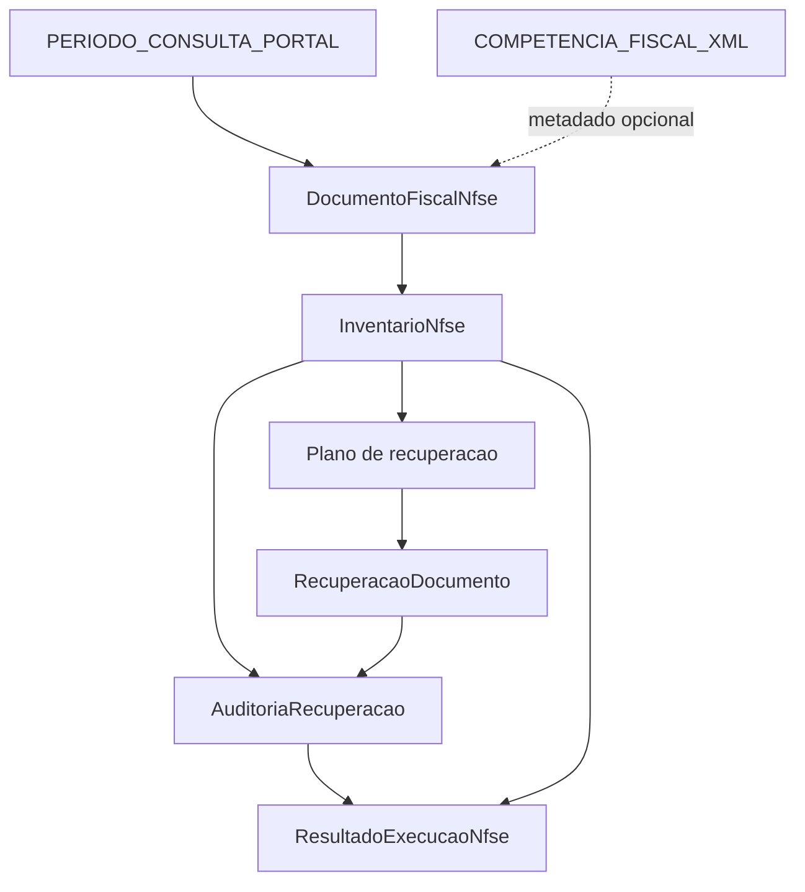
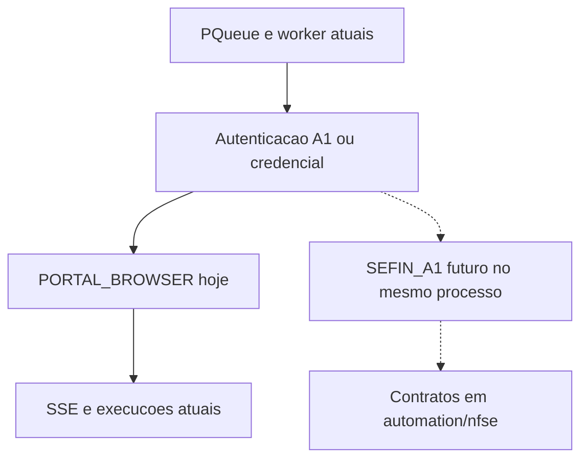

# NFS-e nativa — etapa 22.1 — contratos internos

O AutoNacional é a única aplicação operacional. O processamento futuro de NFS-e vai rodar no mesmo processo Node.js, na mesma fila e na mesma interface.

O NFSExplorer foi uma POC. Validou descoberta no Portal Nacional, chave de 50 dígitos, classificação por `data-situacao`, recuperação SEFIN com certificado A1, auditoria e exportação de XMLs vigentes. Esse repositório não entra no AutoNacional: não há API, processo, CLI, submódulo nem cliente HTTP apontando para ele. O código da POC não foi copiado.

Esta etapa só define contratos e funções puras. O fluxo em produção permanece o de hoje.

## Estrutura nativa

```text
Backend/src/automation/nfse/contracts/
  erros.ts
  periodo.ts
  documento-fiscal.ts
  inventario.ts
  recuperacao.ts
  auditoria.ts
  execucao.ts
  index.ts
  nfse-contracts.test.ts
```

A pasta fica ao lado de `playwright-nfse.ts`, `processar-notas-competencia.ts` e `download-operation.ts`. Nenhum desses arquivos foi alterado e nenhum deles importa `automation/nfse`.

Diretórios de descoberta, classificação, recuperação e auditoria não foram criados. Ainda não há implementação para ocupá-los.

A entrada pública é `Backend/src/automation/nfse/contracts/index.ts`.

| Contrato | Arquivo | Papel |
|---|---|---|
| Período e competência | `periodo.ts` | Separa `PERIODO_CONSULTA_PORTAL` de `COMPETENCIA_FISCAL_XML` |
| Documento fiscal | `documento-fiscal.ts` | Chave, CNPJ, direção, situação, origem e evidências |
| Inventário | `inventario.ts` | Documentos descobertos, totais e completude |
| Recuperação | `recuperacao.ts` | Plano e resultado por chave |
| Auditoria | `auditoria.ts` | Cobertura dos vigentes e aprovação do pacote |
| Processamento | `execucao.ts` | Resultado consolidado e associação método → motor |
| Erro | `erros.ts` | `ContratoNfseError`, só validação local |

Nomes que já descreviam o domínio interno foram mantidos: `DocumentoFiscalNfse`, `InventarioNfse`, `RecuperacaoDocumento`, `AuditoriaRecuperacao` e `ResultadoExecucaoNfse`. `ResultadoExecucaoNfse` acompanha o vocabulário de `execucoes`.

## O que saiu da etapa anterior

A primeira versão destes arquivos estava em `Backend/src/integrations/nfsexplorer/contracts/` e tratava o NFSExplorer como sistema a integrar. Essa pasta foi desfeita. O documento `docs/NFSEXPLORER-INTEGRACAO-22.1.md` era untracked e foi substituído por este.

| Antes | Agora |
|---|---|
| `ContratoIntegracaoError` | `ContratoNfseError` |
| `NFSEXPLORER_A1` | `SEFIN_A1` |
| `LEGADO_CREDENCIAL` | `PORTAL_BROWSER` |
| `integracao-nfsexplorer.contracts.test.ts` | `nfse-contracts.test.ts` |

`SEFIN_A1` é a recuperação futura de XML com o certificado A1 já carregado pelo AutoNacional. `PORTAL_BROWSER` é o download atual pelo navegador do Portal Nacional, o caminho que continua valendo para credencial e que ainda entrega XML e PDF. A associação não está ligada ao worker.

## Regras fiscais

`PERIODO_CONSULTA_PORTAL` é o filtro de datas do Portal Nacional, em `DD/MM/YYYY`. Ele define o inventário, a auditoria e a exportação futura. No código atual esse filtro entra em `#datainicio` e `#datafim`.

`COMPETENCIA_FISCAL_XML` é o `dCompet` do XML. É metadado. Diferença em relação ao período consultado não exclui o documento.

`DocumentoFiscalNfse` guarda:

- `chaveNacional` com 50 dígitos. A chave de 44 dígitos de `extrairIdentificadorDaLinha` não satisfaz este contrato.
- `cnpj` com 14 dígitos, normalizado por `limparDocumento`.
- `direcao`: `EMITIDA` ou `RECEBIDA`. A correspondência com `TipoNotaUi` (`Emitidas` / `Recebidas`) está em `DIRECAO_PARA_TIPO_NOTA_UI`, sem importar o módulo de download.
- `situacao`: `VIGENTE`, `CANCELADA` ou `INDETERMINADA`.
- `periodoConsulta`, `competenciaFiscalXml` opcional, `origemClassificacao` e `evidencias`.

O valor inicial de origem é `NAO_CLASSIFICADA`. Esta etapa não classifica `data-situacao` nem o ícone `cancelada`.

`CANCELADA` permanece no inventário, fica fora da recuperação destinada à importação contábil e fora da exportação dos vigentes.

`INDETERMINADA` permanece no inventário e bloqueia o processamento automático até revisão.

`VIGENTE` é a única situação elegível à recuperação e à exportação de XML.

Cobertura de 100% significa que cada chave vigente tem exatamente um XML utilizável. Cancelada não entra no denominador. Vigente pendente ou ausente impede `CONCLUIDA`.

## Relacionamento



A seta tracejada não filtra o inventário.

### Inventário

`InventarioNfse` reúne os documentos de um CNPJ e de um único período consultado. Emitida cancelada conta como emitida e como cancelada. Não conta como vigente.

`completude` é `COMPLETO`, `PARCIAL` ou `INDETERMINADO`. Quem ler as páginas do portal é que declara esse estado.

### Recuperação

`RECUPERADO` e `REUTILIZADO` exigem caminho do XML e hash SHA-256 de 64 caracteres hexadecimais. O hash não é calculado aqui. `FALHOU` e `BLOQUEADO` exigem motivo e não carregam arquivo. `PENDENTE` não tem arquivo nem motivo.

`montarPlanoRecuperacao` só aplica a regra:

- vigente → `PENDENTE`;
- cancelada → fora da lista;
- indeterminada → `BLOQUEADO`.

### Auditoria

`auditarRecuperacao` compara o inventário com as recuperações. `APROVADA` exige cobertura 1, zero ausentes, zero inválidos, zero duplicados e todas as canceladas excluídas. Cancelada incluída na recuperação reprova, mesmo quando os vigentes estão cobertos. Indeterminada com XML utilizável também reprova.

### Resultado

`consolidarResultadoExecucao` deriva o status nesta ordem:

1. alguma indeterminada → `BLOQUEADA`;
2. cancelada incluída na recuperação, erro, XML inválido ou duplicado → `FALHOU`;
3. vigente pendente ou ausente → `PENDENTE`;
4. auditoria reprovada por outro motivo → `FALHOU`;
5. caso restante → `CONCLUIDA`.

`EM_EXECUCAO` existe no tipo para o worker futuro. O consolidador offline não o emite.

`contagensCompativeis` preenche `qtd_emitidas`, `qtd_recebidas` e `qtd_canceladas`, os campos de `ExecutionEventCounts`. Emitidas e recebidas dessa projeção são só as vigentes de cada direção. Indeterminada aparece em `contagens.indeterminadas` e bloqueia o resultado.

`BLOQUEADA` não tem coluna em `execucoes`. `statusPersistivelEmExecucoes` devolve `null` nesse caso. Os demais status mapeiam para `pendente`, `em_execucao`, `concluido` e `falhou`. Nada é gravado.

### Motores

| Motor | Método | Papel |
|---|---|---|
| `SEFIN_A1` | `CERTIFICADO` | Recuperação SEFIN com certificado A1, ainda não chamada |
| `PORTAL_BROWSER` | `CREDENCIAL` | Download atual pelo navegador, inclusive XML e PDF |

`CERTIFICADO` e `CREDENCIAL` são o vocabulário de `ExecutionEventStarted.metodo` e de `LoginMetodo`. `METODO_PARA_TIPO_AUTENTICACAO` registra o par do worker: `certificado` e `credenciais`.

`motorAssociadoAoMetodo` lê essa tabela. Um par incoerente é recusado pelo consolidador. O worker, a `PQueue` e os oito navegadores não consultam essa tabela.

## Componentes preservados

Permanecem como estão:

- `execution-service.ts` e a `PQueue`;
- `playwright-nfse.ts` e o login A1;
- `login-credencial-nfse.ts`;
- `processar-notas-competencia.ts`;
- `download-operation.ts`, inclusive PDF/DANFS-e;
- `captcha-window-manager.ts` e o CAPTCHA manual;
- a Central por screenshots;
- SSE, PostgreSQL, Prisma, frontend, storage e downloads atuais.

O PDF continua no fluxo do navegador. A POC validou principalmente XML. A estratégia futura de PDF fica para uma etapa própria.

## Pontos futuros

O encaixe previsto continua sendo o trecho de `executarFluxoCompleto` depois da autenticação e antes de `processarTabelaEmitidas` / `processarTabelaRecebidas`. Nada disso foi ligado.

1. Descobrir chaves e situação na page já autenticada e montar `InventarioNfse`.
2. Recuperar XML só das vigentes com o PFX já em memória, em diretório novo.
3. Auditar a cobertura e, em falha do caminho novo, voltar ao processamento atual daquela empresa.
4. Publicar contagens novas como campos opcionais do SSE, mantendo os três contadores atuais.

Credencial permanece em `PORTAL_BROWSER`. Certificado só passa a `SEFIN_A1` quando essa chamada existir dentro do backend.



A seta tracejada não existe no código.

## O que esta etapa não faz

- Não descobre notas, não lê `dCompet`, não baixa arquivo e não calcula hash.
- Não chama Portal Nacional, SEFIN, ADN nem Playwright.
- Não seleciona motor dentro do worker.
- Não cria flag, rota, fila, processo, migração nem evento SSE.
- Não grava `BLOQUEADA`.
- Não detecta paginação: a completude é informada por quem chamar `montarInventario`.
- Diretórios em `artefatos` são texto.
- Origens `PORTAL`, `XML` e `REVISAO_MANUAL` são valores aceitos. Nada neste repositório as preenche a partir do portal.

## Ausência de dependência externa

Os contratos importam apenas módulos locais do backend. A única dependência de código já existente é `limparDocumento`. Não há import de outro repositório, caminho absoluto fora do projeto, `fetch`, Playwright, Prisma, shell ou leitura de certificado.

Remover a POC do computador não altera estes arquivos.

## Testes

Arquivo: `Backend/src/automation/nfse/contracts/nfse-contracts.test.ts`.

Cobre chave de 50 dígitos, CNPJ normalizado, situações, emitidas e recebidas, canceladas, indeterminadas, período consultado independente de `dCompet`, plano de recuperação, cobertura integral, cobertura parcial com status `PENDENTE`, duplicidade, falha e resultado consolidado.

Executado em 19/10/2026, no diretório `Backend`:

- `npm run typecheck` passou (`tsc --noEmit`).
- `npm test` passou. Vitest 3.2.7: 20 arquivos, 185 testes. O arquivo `nfse-contracts.test.ts` contribuiu 11.

Fora desta execução, por dependerem de serviço externo ou navegador: `npm run test:smoke-db`, `npm run test:smoke-storage` e `npm run test:playwright`.

O operador revisa o diff antes de qualquer commit.
