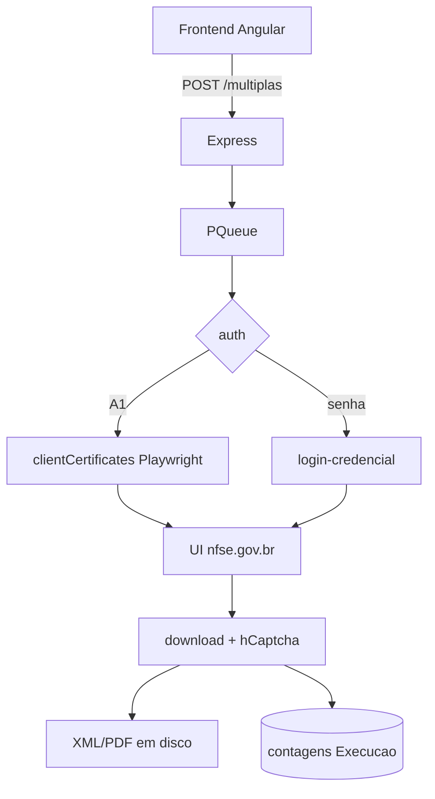

# 00 — Resumo executivo (handoff)

Documento de handoff para outra IA ou equipe criar uma POC de API NFS-e independente. Base: análise estática do repositório AutoNacional. Sem execução de automação, browser ou rede externa nesta auditoria.

## Objetivo do sistema atual

Automatizar, via **Playwright Chromium**, o download de XML e DANFS-e (PDF) de notas **emitidas** e **recebidas** no portal **Emissor Nacional** (`www.nfse.gov.br`), com autenticação por **certificado A1 (PFX)** ou **credencial**, fila in-process, CAPTCHA no download e persistência de arquivos no filesystem + contagens no PostgreSQL.

## Stack confirmada

| Camada | Tecnologia | Evidência |
|--------|------------|-----------|
| Runtime | Node ≥18, npm ≥9 | `Backend/package.json` engines L39–41 |
| API | Express 4 | `main.ts`, deps |
| ORM/DB | Prisma 7 + PostgreSQL | `schema.prisma`, `@prisma/client` |
| Browser | Playwright 1.58 Chromium | `playwright` dep; `chromium.launch` |
| UI | Angular 17 | `Frontend/package.json` |
| Fila | `p-queue` (concurrency default 3) | `execution-service.ts` L363–366 |
| Logs | `pino` | deps + logger |
| Cert parse | `node-forge` | importação PFX |
| Tempo real | `socket.io` | Central captcha |

## Arquitetura em uma frase

Frontend Angular chama `POST /api/execucao/multiplas` → Express enfileira em `PQueue` → worker autentica no portal (A1 via `clientCertificates` ou login/senha) → navega Notas Emitidas/Recebidas → filtra datas → clica download por linha → resolve hCaptcha se necessário → salva em `{base}/{contabilidade}/{mês-execução}/{empresa}/{Emitidas|Recebidas}/` → grava contagens em `Execucao`.

Diagrama:



Detalhes: [01-ARQUITETURA-ATUAL.md](./01-ARQUITETURA-ATUAL.md), [02-FLUXO-AUTOMACAO.md](./02-FLUXO-AUTOMACAO.md).

## Autenticação A1 (resumo)

- PFX no storage + senha AES no DB → `CertificadoEmMemoria {pfx, passphrase}`.
- mTLS **somente** via Playwright `clientCertificates` em `www.nfse.gov.br` e `certificado.nfse.gov.br`.
- Browser **efêmero**; sem perfil persistente; sem `https.Agent`.
- Detalhes: [03-CERTIFICADOS-A1.md](./03-CERTIFICADOS-A1.md).

## Emitidas vs Recebidas

| | Emitidas | Recebidas |
|---|----------|-----------|
| Menu | `li:nth-of-type(3)` | `li:nth-of-type(4)` |
| URL | `/Notas/Emitidas` | `/Notas/Recebidas` |
| Coluna ações | 6 | 5 |
| Extração DOM | chave 44 + heurística número | igual |

Sem parser XML fiscal; sem tabela de notas no Prisma. Detalhes: [04-NOTAS-EMITIDAS-RECEBIDAS.md](./04-NOTAS-EMITIDAS-RECEBIDAS.md).

## HTTP / APIs

- Portal: apenas URLs de **páginas UI** (não API REST oficial no código).
- `fetch` externo: **2Captcha** apenas.
- `baixarArquivoDireto` (`page.request.get`) existe mas **não é chamado** no fluxo principal.
- Integração ADN / API oficial Emissor: **NÃO IDENTIFICADO NO CÓDIGO**.
- Detalhes: [05-ENDPOINTS-HTTP.md](./05-ENDPOINTS-HTTP.md).

## CAPTCHA e navegador

- hCaptcha só no **download** (`#btnSubmitHCaptcha`), não no login A1.
- Modos lote: `TWO_CAPTCHA` | `MANUAL`; env `CAPTCHA_MODE` auto/manual/auto_manual; Central Socket.IO opcional.
- Detalhes: [06-CAPTCHA-E-NAVEGADOR.md](./06-CAPTCHA-E-NAVEGADOR.md).

## Armazenamento XML

Path **real**:

```text
{base}/{contabilidade}/{mes_extenso-ano}/{razaoSocial}/{Emitidas|Recebidas}/
```

- Mês = mês da **execução** (não competência da nota).
- Setting `downloadsPattern` default `{cnpj}/{ano}/{mes}` **não** é usado em `salvarDownloadDireto` (divergência documentada).
- Detalhes: [07-ARMAZENAMENTO-XML.md](./07-ARMAZENAMENTO-XML.md).

## Filas

- `PQueue` in-process; sem Redis/cron/worker externo.
- Skip de arquivo válido; sem resume de job.
- Detalhes: [08-FILAS-E-CONCORRENCIA.md](./08-FILAS-E-CONCORRENCIA.md).

## Reutilizáveis para POC

| Peça | Classificação |
|------|---------------|
| Loader PFX + decrypt | ADAPTÁVEL |
| Auth portal Playwright | NÃO REUTILIZÁVEL (mTLS browser) |
| Path de pastas (regras) | ADAPTÁVEL (POC pode alinhar CNPJ/competência) |
| Parser XML fiscal | NÃO IDENTIFICADO |
| Download UI + CAPTCHA | NÃO REUTILIZÁVEL |
| Histórico por chave | NÃO IDENTIFICADO (só contagens + FS) |
| p-queue / pino | ADAPTÁVEL |

Detalhes: [09-COMPONENTES-REUTILIZAVEIS.md](./09-COMPONENTES-REUTILIZAVEIS.md).

## Dependências críticas (se espelhar partes do monorepo)

- `playwright` + Chromium (só se mantiver UI)
- `node-forge` (import/parse PFX)
- crypto interna (`decryptPassword`) + storage de certs
- `TWOCAPTCHA_API_KEY` se mantiver download UI
- PostgreSQL/Prisma se mantiver multi-empresa

## Limitações críticas (para handoff)

1. Não há cliente da API oficial ADN no repositório.
2. Autenticação A1 está acoplada ao Chromium Playwright.
3. Metadados fiscais não são parseados do XML; DB não indexa notas.
4. Path de download diverge do setting `downloadsPattern`.
5. CAPTCHA é custo/complexidade do caminho UI; API oficial provavelmente elimina quase todo o pipeline Playwright.

Plano POC (protocolo futuro, **não executado**): [10-PLANO-POC-API.md](./10-PLANO-POC-API.md).  
Lacunas: [11-PERGUNTAS-E-LACUNAS.md](./11-PERGUNTAS-E-LACUNAS.md).

---

## Contexto para criação de um repositório independente

Objetivo sugerido: **POC Node em macOS local**, uma empresa, certificado A1, volume >150 NFS-e/mês, **sem** depender da automação Playwright do AutoNacional e **sem** copiar o monorepo Angular/Prisma/fila completa.

### O que a POC deve assumir como ponto de partida

| Tema | Realidade AutoNacional | Implicação para repo novo |
|------|------------------------|---------------------------|
| Auth | PFX + senha em memória; mTLS só no browser | Reusar ideia de `{pfx, passphrase}`; implementar mTLS HTTP **do zero** (ou SDK oficial), validar em runtime |
| Listagem/download | DOM + CAPTCHA | Preferir ADN/API oficial se disponível; senão, automação UI continua sendo o único caminho comprovado **neste** repo |
| Persistência | Contagens + pastas por razão social / mês execução | POC deve definir schema próprio (chave 44, competência, paths por CNPJ) |
| Config | Settings + DB | Preferir `.env` + pasta local de PFX para single-company |
| CAPTCHA / Socket.IO / PQueue multi | Necessários no produto atual | Fora de escopo se API oficial funcionar |

### Requisitos mínimos sugeridos (macOS / Node)

- Node ≥18
- Certificado A1 PFX da empresa + senha (ambiente local seguro; nunca commit)
- Acesso de rede ao ambiente oficial (ADN/Emissor — URLs só como contexto externo; **não** presentes como integração neste código)
- Pasta de saída com naming explícito (recomendado: `{cnpj}/{ano}/{mes}/…` para reconciliar com o setting histórico, **não** com o path real atual do AutoNacional)
- Critérios de sucesso: autenticar, listar/baixar >150 XMLs, comparar chaves/arquivos com pasta de referência gerada pela automação atual (se disponível)

### O que **não** copiar

- Pipeline Playwright de menus/tabelas/captcha (a menos que a API falhe)
- Frontend Angular, Socket.IO Central, métricas de rentabilidade
- Expectativa de tabela `Execucao` como inventário fiscal

### Ordem de leitura recomendada para a outra IA

1. Este resumo  
2. `03-CERTIFICADOS-A1.md` + `09-COMPONENTES-REUTILIZAVEIS.md`  
3. `05-ENDPOINTS-HTTP.md` + `10-PLANO-POC-API.md`  
4. `07-ARMAZENAMENTO-XML.md` + `11-PERGUNTAS-E-LACUNAS.md`  
5. Código-fonte citado apenas se for extrair o loader PFX
