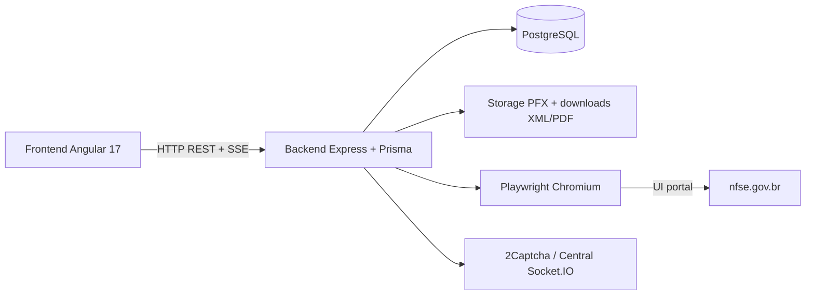
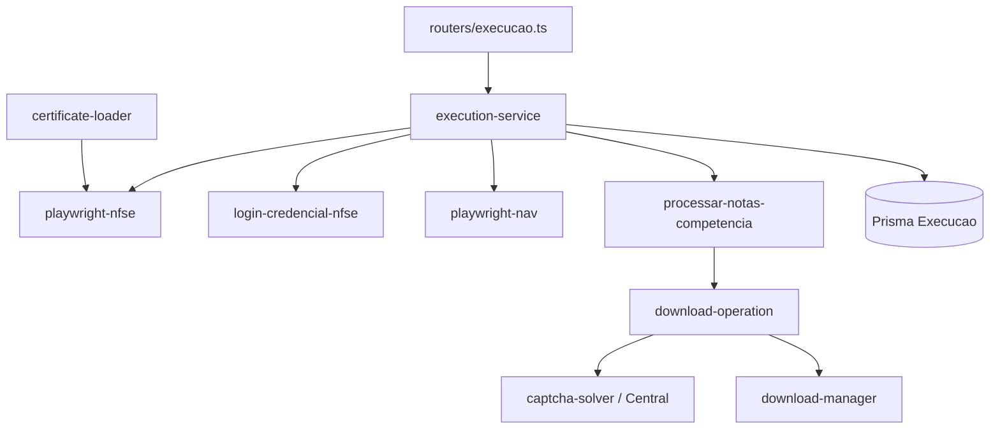

# 01 — Arquitetura atual

Mapa estático do monorepo AutoNacional com ownership dos módulos relevantes à automação NFS-e.

## Visão geral

## Monorepo

| Parte | Path | Papel |
|-------|------|-------|
| Backend | `Backend/` | API Express, automação Playwright, Prisma, filas |
| Frontend | `Frontend/` | UI Angular 17 (execução, empresas, certificados, settings) |
| Docs | `docs/` | Documentação técnica e esta auditoria |

## Engines e stack

| Evidência | Detalhe |
|-----------|---------|
| Arquivo / Campo / Linhas / Evidência | `Backend/package.json` / `engines` / L39–41 / `node >=18.0.0`, `npm >=9.0.0` |
| Arquivo / Campo / Linhas / Evidência | `Frontend/package.json` / `engines` / L16–18 / mesmos requisitos |
| Arquivo / Deps / Evidência | `Backend/package.json` / `dependencies` / L56–71 / `express`, `@prisma/client`, `playwright`, `p-queue`, `pino`, `node-forge`, `socket.io`, `pg`, `zod` |
| Arquivo / Deps / Evidência | `Frontend/package.json` / `dependencies` / L20–37 / Angular 17, `socket.io-client` |

### Dependências por categoria (Backend)

| Categoria | Pacotes |
|-----------|---------|
| HTTP API | `express`, `cors`, `multer`, `zod` |
| Persistência | `@prisma/client`, `@prisma/adapter-pg`, `pg` |
| Automação UI | `playwright` |
| Concorrência | `p-queue` |
| Certificados A1 | `node-forge` (parse PFX/CNPJ na importação) |
| Logs | `pino` |
| Tempo real | `socket.io` (Central de captcha manual) |
| Outros | `ssh2` (storage remoto opcional), `xlsx`, `dotenv` |

**NÃO IDENTIFICADO NO CÓDIGO:** cliente HTTP mTLS (`https.Agent`), SDKs ADN/Emissor Nacional, parsers XML fiscais (`fast-xml-parser`, etc.), filas externas (Redis/Bull).

## Entrypoints

| Evidência | Detalhe |
|-----------|---------|
| Arquivo / Função / Linhas / Evidência | `Backend/src/main.ts` / bootstrap Express / L51–105 / monta routers `/api/*`, health, CORS |
| Arquivo / Scripts / Evidência | `Backend/package.json` / `scripts` / L6–25 / `dev` → `src/main.ts`; `start` → `dist/main.js`; `playwright:install`; Prisma |
| Arquivo / Scripts / Evidência | `Frontend/package.json` / `scripts` / L5–13 / `ng serve --port 1234` |

Wiring do loader de certificado:

| Evidência | Detalhe |
|-----------|---------|
| Arquivo / Função / Linhas / Evidência | `Backend/src/main.ts` / bootstrap / (import L44 + `setCertificateLoader`) / liga `carregarCertificadoPorCnpj` ao `execution-service` |

## Ownership dos módulos (automação)

| Módulo | Path real | Responsabilidade |
|--------|-----------|------------------|
| Orquestração / fila | `Backend/src/services/execution-service.ts` | `PQueue`, `adicionarExecucao`, `executarFluxoCompleto`, `finalizarExecucao` |
| Auth A1 | `Backend/src/automation/playwright-nfse.ts` + `certificate-loader.ts` | Chromium + `clientCertificates` |
| Auth credencial | `Backend/src/automation/login-credencial-nfse.ts` | Login CNPJ/CPF + senha no portal |
| Navegação menus | `Backend/src/automation/playwright-nav.ts` | `clicarMenuNotasEAguardar`, goto com retry |
| Tabelas / competência | `Backend/src/automation/processar-notas-competencia.ts` | Filtro datas, paginação, emitidas/recebidas |
| Download + CAPTCHA | `Backend/src/automation/download-operation.ts` | Clique XML/PDF, hCaptcha, retry |
| Persistência FS | `Backend/src/automation/download-manager.ts` | Path, save, validação, skip |
| CAPTCHA providers | `Backend/src/automation/captcha/*`, `captcha-solver.ts` | 2Captcha / MANUAL |
| Central manual | `Backend/src/services/manual-captcha.service.ts` + Socket.IO | Cliques remotos |
| Schema DB | `Backend/prisma/schema.prisma` | Empresas, certificados, execuções (contagens) |
| API execução | `Backend/src/routers/execucao.ts` | `POST /multiplas`, SSE stream |

## Diagrama de ownership no fluxo

## Persistência vs filesystem

| Camada | O que guarda | Evidência |
|--------|--------------|-----------|
| PostgreSQL | Empresas, certificados (path relativo + senha AES), settings, contagens de execução | `schema.prisma` models `Empresa`, `Certificado`, `Settings`, `Execucao` |
| Disco PFX | Arquivo `.pfx` sob path relativo tipo `contabilidade/.../certs/` | `certificate-storage.ts` L1–5 |
| Disco XML/PDF | Hierarquia contabilidade/mês-execução/empresa/tipo | `download-manager.ts` `montarCaminhoCompleto` L155–171 |

## Frontend (papel na arquitetura)

O Angular dispara lotes e acompanha progresso (SSE/polling). Não executa Playwright. Settings expõem `downloadsPattern` na UI, mas o save real de XML **não** usa esse pattern (ver `07-ARMAZENAMENTO-XML.md`).

| Evidência | Detalhe |
|-----------|---------|
| Arquivo / Campo / Evidência | `Frontend/.../configuracoes.component.ts` / form `downloadsPattern` / default `{cnpj}/{ano}/{mes}` |
| Arquivo / Função / Linhas / Evidência | `Backend/src/routers/settings.ts` / `POST /test-paths` / L285–301 / preview do pattern — não é o path de `salvarDownloadDireto` |
