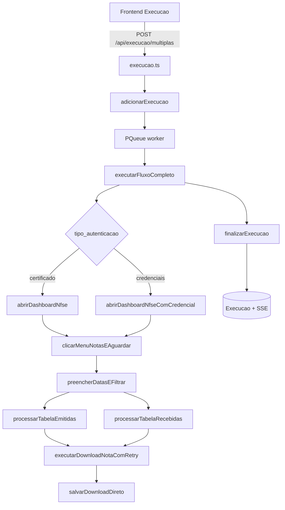

# 02 — Fluxo de automação

Cadeia completa desde o disparo HTTP até a finalização da execução, com evidências estáticas.

## Diagrama ponta a ponta



## 1. Disparo HTTP

| Evidência | Detalhe |
|-----------|---------|
| Arquivo / Rota / Linhas / Evidência | `Backend/src/routers/execucao.ts` / `POST /multiplas` / L75–85+ / enfileira múltiplas empresas |
| Arquivo / Montagem / Linhas / Evidência | `Backend/src/main.ts` / `app.use` / L99 / `/api/execucao` |
| Arquivo / SSE / Linhas / Evidência | `Backend/src/routers/execucao.ts` / `GET /stream/:batch_id` / L284–286 / progresso em tempo real |

## 2. Enfileiramento

| Evidência | Detalhe |
|-----------|---------|
| Arquivo / Função / Linhas / Evidência | `execution-service.ts` / `adicionarExecucao` / L194–275 / cria registro Prisma, popula `execucoesAtivas`, `fila.add(() => executarFluxoCompleto(...))` |
| Arquivo / Constante / Linhas / Evidência | `execution-service.ts` / `fila` / L363–366 / `new PQueue({ concurrency: 3 })` |
| Arquivo / Função / Linhas / Evidência | `execution-service.ts` / `configurarConcorrenciaParaBatch` / L137–159 / `min(default, max, slots, totalEmpresas)` |

Parâmetros relevantes na fila: `empresaId`, `cnpj`, `dataInicio`/`dataFim`, `tipo` (`ambas`\|`emitidas`\|`recebidas`), `headless`, `tipoAutenticacao`, `baixarPdf`, `captchaMode`, `batchId`.

Modo MANUAL força browser visível:

| Evidência | Detalhe |
|-----------|---------|
| Arquivo / Função / Linhas / Evidência | `execution-service.ts` / `adicionarExecucao` / L211–216 / `captchaMode === 'MANUAL' ? false : headless…` |

## 3. Autenticação

### Certificado A1

| Evidência | Detalhe |
|-----------|---------|
| Arquivo / Função / Linhas / Evidência | `execution-service.ts` / `executarFluxoCompleto` / L725–753 / carrega cert via loader ou parâmetro → `abrirDashboardNfse` |
| Arquivo / Função / Linhas / Evidência | `certificate-loader.ts` / `carregarCertificadoPorCnpj` / L24–77 / PFX do storage + senha decrypt |
| Arquivo / Função / Linhas / Evidência | `playwright-nfse.ts` / `abrirDashboardNfse` / L131–388 / goto portal + clique “Certificado” |

Seleção de certificado: **por CNPJ da empresa** (`obterPorCnpj`), não por picker de UI no browser (mTLS via `clientCertificates`).

### Credenciais

| Evidência | Detalhe |
|-----------|---------|
| Arquivo / Função / Linhas / Evidência | `execution-service.ts` / L698–724 / `credenciaisRepo.obterPrimeiraPorEmpresa` → `abrirDashboardNfseComCredencial` |

## 4. Navegação e competência

Pastas e nome da empresa:

| Evidência | Detalhe |
|-----------|---------|
| Arquivo / Função / Linhas / Evidência | `execution-service.ts` / L786–793 / `basePath` de settings; `nomeEmpresa` = razão social; `mesExecucaoExtenso` = mês **atual da execução** (`formatarMesExecucaoParaPasta(agora)`) |
| Arquivo / Função / Linhas / Evidência | `execution-service.ts` / `obterNomeEmpresa` / L181–186 / fallback para CNPJ se sem razão social |

Menus:

| Evidência | Detalhe |
|-----------|---------|
| Arquivo / Função / Linhas / Evidência | `execution-service.ts` / L808–812 / Emitidas: `li:nth-of-type(3) img` |
| Arquivo / Função / Linhas / Evidência | `execution-service.ts` / L885–888 / Recebidas: `li:nth-of-type(4) img` |
| Arquivo / Função / Linhas / Evidência | `playwright-nav.ts` / `clicarMenuNotasEAguardar` / L138–174 / espera URL `/Notas/{Emitidas\|Recebidas}` e `#datainicio` |

Filtro de período (competência da consulta UI):

| Evidência | Detalhe |
|-----------|---------|
| Arquivo / Função / Linhas / Evidência | `processar-notas-competencia.ts` / `preencherDatasEFiltrar` / L766–786 / `#datainicio`, `#datafim` + botão filtrar |

## 5. Processamento de tabelas

| Evidência | Detalhe |
|-----------|---------|
| Arquivo / Função / Linhas / Evidência | `processarTabelaEmitidas` / L639–696 / loop linhas + paginação |
| Arquivo / Função / Linhas / Evidência | `processarTabelaRecebidas` / L703–760 / mesmo padrão com tipo `Recebidas` |
| Arquivo / Função / Linhas / Evidência | `verificarSemRegistros` / L463–482 / “Nenhum registro encontrado” |
| Arquivo / Função / Linhas / Evidência | `verificarNotaValida` / L512–518 / skip canceladas (contagem separada) |

## 6. Download e CAPTCHA

| Evidência | Detalhe |
|-----------|---------|
| Arquivo / Função / Linhas / Evidência | `baixarArquivosDaLinha` / L525–632 / XML obrigatório; PDF se `baixarPdf` |
| Arquivo / Função / Linhas / Evidência | `download-operation.ts` / `executarTentativaDeDownload` / L582–627 / clique link → event `download` → `salvarDownloadDireto` |
| Arquivo / Função / Linhas / Evidência | `tentarResolverCaptchaSeNecessario` / L497–579 / só se `#btnSubmitHCaptcha` aparecer |

## 7. Resultado e finalização

Classificação de resultado:

| Evidência | Detalhe |
|-----------|---------|
| Arquivo / Função / Linhas / Evidência | `execution-service.ts` / L953–960 / `SEM_MOVIMENTO` / `NOTAS_EMITIDAS` / `NOTAS_RECEBIDAS` / `NFS_ENCONTRADAS` |

| Evidência | Detalhe |
|-----------|---------|
| Arquivo / Função / Linhas / Evidência | `finalizarExecucao` / L464–559 / atualiza DB, SSE `execution:finished`, fecha page/browser, libera slot |

### Pendente vs processado

- **Pendente:** status inicial em `adicionarExecucao` (`status: 'pendente'`, mensagem “Aguardando execução…”).
- **Em execução:** `status: 'em_execucao'` ao abrir browser (L661–670).
- **Concluído / falhou:** `finalizarExecucao`.
- **Idempotência de arquivo:** skip se XML/PDF válido já existe (`localizarArquivoExistenteValido`) — ver `07` e `08`.
- **Resume de job interrompido:** NÃO IDENTIFICADO NO CÓDIGO (só skip de arquivo no FS).

## Diretórios criados na execução

Hierarquia efetiva:

```text
{downloadsBasePath}/{contabilidade}/{mes_extenso-ano}/{razaoSocial}/{Emitidas|Recebidas}/
```

| Evidência | Detalhe |
|-----------|---------|
| Arquivo / Função / Linhas / Evidência | `download-manager.ts` / `montarCaminhoCompleto` / L155–171 |
| Arquivo / Função / Linhas / Evidência | `execution-service.ts` / L786–793 / monta inputs do path |
