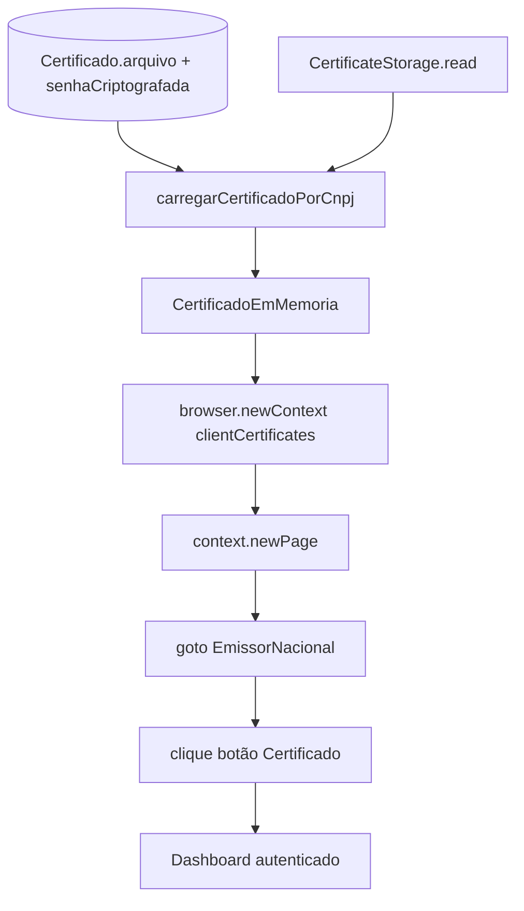

# 03 — Certificados A1

Fluxo real de autenticação por certificado digital A1 (PFX/P12) no AutoNacional. Sem expor segredos, paths absolutos sensíveis ou senhas.

## Fluxo real (substitui o genérico)

```text
PFX em storage (path relativo por contabilidade/empresa/CNPJ)
  → carregarCertificadoPorCnpj (decrypt senha AES no DB)
  → CertificadoEmMemoria { pfx: Buffer, passphrase: string }
  → criarContextoComCertificado (Playwright clientCertificates × 2 origins)
  → abrirDashboardNfse (goto + clique Certificado)
  → sessão browser Chromium efêmera (sem perfil persistente)
```



## 1. Armazenamento do PFX

| Evidência | Detalhe |
|-----------|---------|
| Arquivo / Comentário / Linhas / Evidência | `certificate-storage.ts` / interface / L1–5 / paths relativos ex.: `contabilidade/1/empresa/{cnpj}/certs/arquivo.pfx`; path físico não vai ao banco |
| Arquivo / Model / Linhas / Evidência | `schema.prisma` / `Certificado` / L77–89 / `arquivo` (path storage), `senhaCriptografada`, `cnpj` |
| Arquivo / Função / Linhas / Evidência | `certificate-loader.ts` / `carregarCertificadoPorCnpj` / L50–53 / `storage.read(cert.arquivo)` |

Drivers: local e/ou SFTP via abstração `getCertificateStorage()` (ver `Backend/src/storage/`). Conteúdo em memória como `Buffer`.

## 2. Senha

| Evidência | Detalhe |
|-----------|---------|
| Arquivo / Função / Linhas / Evidência | `certificate-loader.ts` / L67–74 / `decryptPassword(cert.senhaCriptografada)`; erro menciona `CRYPTO_KEY` / `APP_CRED_KEY` |
| Arquivo / Função / Linhas / Evidência | `certificate-loader.ts` / L43–47 / falha se senha não armazenada (reimportar na UI) |

**Não documentar valores de chaves.** Apenas: senha está criptografada no PostgreSQL e só é descriptografada no processo do backend no momento do load.

## 3. Tipagem em memória

| Evidência | Detalhe |
|-----------|---------|
| Arquivo / Interface / Linhas / Evidência | `playwright-nfse.ts` / `CertificadoEmMemoria` / L34–38 / `{ pfx: Buffer; passphrase: string }` |
| Arquivo / Retorno / Linhas / Evidência | `certificate-loader.ts` / L77 / `return { pfx, passphrase }` |

## 4. mTLS via Playwright (não via Node https)

| Evidência | Detalhe |
|-----------|---------|
| Arquivo / Função / Linhas / Evidência | `playwright-nfse.ts` / `criarContextoComCertificado` / L90–118 / `chromium.launch` + `browser.newContext({ clientCertificates: [...] })` |
| Arquivo / Origins / Linhas / Evidência | L106–117 / `https://www.nfse.gov.br` **e** `https://certificado.nfse.gov.br` (comentário L102–105: IIS 403 se faltar o segundo) |

### O que **não** existe

| Item | Status |
|------|--------|
| `https.Agent` com PFX | NÃO IDENTIFICADO NO CÓDIGO |
| Conversão OpenSSL PEM para mTLS HTTP | NÃO IDENTIFICADO NO CÓDIGO (há `NODE_OPTIONS=--openssl-legacy-provider` só no npm script de runtime Node) |
| `launchPersistentContext` / userDataDir / cookies persistentes | NÃO IDENTIFICADO NO CÓDIGO |
| `channel: 'chrome'` (Chrome instalado) | NÃO IDENTIFICADO NO CÓDIGO — usa Chromium do Playwright |

| Evidência | Detalhe |
|-----------|---------|
| Arquivo / Função / Linhas / Evidência | `playwright-nfse.ts` / `chromium.launch` / L90–93 / browser efêmero |
| Arquivo / Scripts / Evidência | `Backend/package.json` / L7–9 / `--openssl-legacy-provider` no `dev`/`start` (compat Node/OpenSSL legado, **não** pipeline de cert PEM) |

## 5. Login na UI do portal

| Evidência | Detalhe |
|-----------|---------|
| Arquivo / Constante / Linhas / Evidência | `playwright-nfse.ts` / `BASE_URL` / L25 / `https://www.nfse.gov.br/EmissorNacional/` |
| Arquivo / Função / Linhas / Evidência | `abrirDashboardNfse` / L183–188 / seletores botão Certificado |
| Arquivo / Função / Linhas / Evidência | L286–307 / clique + wait URL Dashboard / MeusDados |

**CAPTCHA no login A1:** NÃO IDENTIFICADO NO CÓDIGO — hCaptcha aparece no fluxo de **download** (`#btnSubmitHCaptcha`), não neste módulo.

## 6. Parse PFX na importação (node-forge)

Usado para extrair metadados (CNPJ, validade) na cadastro/importação — **não** para mTLS HTTP.

| Evidência | Detalhe |
|-----------|---------|
| Arquivo / Função / Evidência | `Backend/src/utils/certificado-utils.ts` / `forge.pkcs12.pkcs12FromAsn1` |
| Arquivo / Função / Evidência | `Backend/src/utils/certificado.parser.ts` / bags `certBag` |

## 7. Avaliação de reuso para POC mTLS HTTP (Node)

| Aspecto | Classificação | Nota |
|---------|---------------|------|
| Buffer PFX + passphrase em memória | **ADAPTÁVEL** | Contrato `CertificadoEmMemoria` é agnóstico de Playwright |
| Loader + decrypt + storage | **ADAPTÁVEL** | Extrair `certificate-loader` + crypto + storage |
| `clientCertificates` Playwright | **NÃO REUTILIZÁVEL** para cliente HTTP puro | Específico do browser |
| Cliente `https`/`undici` com mTLS | **NÃO IDENTIFICADO** | Precisa ser escrito na POC; validade runtime **não testada** nesta auditoria |

**Conclusão estática:** o material criptográfico (PFX+senha) é reutilizável; o mecanismo atual de autenticação no portal é **browser-only**. Não há prova no repositório de que o mesmo PFX funciona com `https.request` / Agent sem Playwright.
