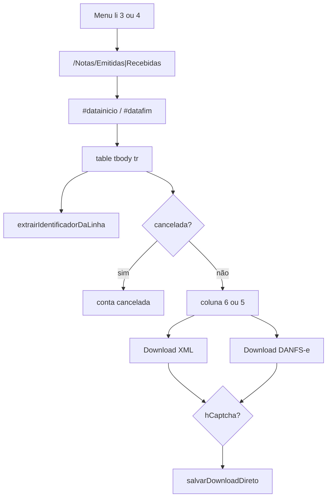

# 04 — Notas emitidas e recebidas

Diferenças e similaridades entre os fluxos de Emitidas e Recebidas no portal, com classificação dos campos.

## Diferenças operacionais

| Aspecto | Emitidas | Recebidas | Evidência |
|---------|----------|-----------|-----------|
| Menu DOM | `li:nth-of-type(3) img` | `li:nth-of-type(4) img` | `execution-service.ts` L808–812 / L885–888 |
| URL esperada | `/Notas/Emitidas` | `/Notas/Recebidas` | `playwright-nav.ts` L146–147 |
| Coluna de ações | índice **6** | índice **5** | `download-operation.ts` / `abrirMenuEObterLink` L475 |
| Pasta destino | `…/Emitidas/` | `…/Recebidas/` | `montarCaminhoCompleto` exige esses literais |
| Função processadora | `processarTabelaEmitidas` | `processarTabelaRecebidas` | `processar-notas-competencia.ts` L639 / L703 |

## Componentes compartilhados

| Componente | Uso |
|------------|-----|
| `preencherDatasEFiltrar` | Mesmos `#datainicio` / `#datafim` |
| `verificarSemRegistros` | Texto “Nenhum registro encontrado” |
| `verificarNotaCancelada` / `verificarNotaValida` | Colunas 4–5 com img “cancelada” |
| `baixarArquivosDaLinha` | XML + PDF opcional |
| `extrairIdentificadorDaLinha` | Chave 44 + heurística número |
| `executarDownloadNotaComRetry` | CAPTCHA + save |
| Paginação | `fa-angle-right` |

## Links de download (menu suspenso)

| Evidência | Detalhe |
|-----------|---------|
| Arquivo / Função / Linhas / Evidência | `download-operation.ts` / `abrirMenuEObterLink` / L470–494 / abre ícone ações → menu; XML: role “Download XML” ou `a:has-text("XML")`; PDF: “Download DANFS-e” ou `DANFS-e` |

## Tabela de campos (classificação)

Legenda: **DOM** = presente na UI e lido; **Extraído** = usado pela automação; **Só XML** = teoricamente no arquivo, sem parser no repo; **Não localizado** = não há leitura no código.

| Campo | Emitidas | Recebidas | Classificação | Evidência |
|-------|----------|-----------|---------------|-----------|
| Chave NFS-e (44 dígitos) | Sim | Sim | DOM → Extraído | `extrairIdentificadorDaLinha` L201–204 (regex `\d{44}` no texto/HTML da linha) |
| Número da nota | Heurística | Heurística | DOM → Extraído (parcial) | `acharNumeroNota` L232–238 — primeiros textos com dígito nas 4 primeiras células |
| CNPJ tomador | — | — | Não localizado | Sem parser de coluna específica |
| CNPJ prestador | — | — | Não localizado | Idem |
| Razão social contraparte | — | — | Não localizado | Idem |
| Valor | — | — | Não localizado | Idem |
| Competência da nota | — | — | Não localizado no DOM parser | Filtro usa datas da **execução** (`preencherDatasEFiltrar`); path usa mês da **execução**, não competência da nota |
| Situação / cancelada | Sim | Sim | DOM → Extraído | `verificarNotaCancelada` L488–505 |
| Tipo Emitida/Recebida | Pasta + ctx | Pasta + ctx | Extraído (parâmetro) | `tipoNota` em download |
| Conteúdo fiscal completo | XML em disco | XML em disco | Só XML | Sem parser fiscal no código |
| Índice de notas no DB | Contagem | Contagem | Extraído (agregado) | `Execucao.qtdNotasEmitidas/Recebidas` — sem tabela de nota |

### Extração de identificador (detalhe)

| Evidência | Detalhe |
|-----------|---------|
| Arquivo / Função / Linhas / Evidência | `download-operation.ts` / `extrairIdentificadorDaLinha` / L187–229 / prioriza 44 dígitos; senão composto `numero\|textos…` ou `row-{timestamp}` |

## Fluxo comum (Mermaid)

## Contagens vs inventário

A automação incrementa `qtd_baixadas` por linha válida processada (tentativa de download), não por reconciliação de chave no banco.

| Evidência | Detalhe |
|-----------|---------|
| Arquivo / Função / Linhas / Evidência | `processarTabelaEmitidas` / L670–684 / `qtdBaixadas++` após `baixarArquivosDaLinha` se válida |
| Arquivo / Model / Evidência | `schema.prisma` / `Execucao` / L163–164 / só inteiros agregados |

**Tabela Prisma de nota individual:** NÃO IDENTIFICADO NO CÓDIGO.
