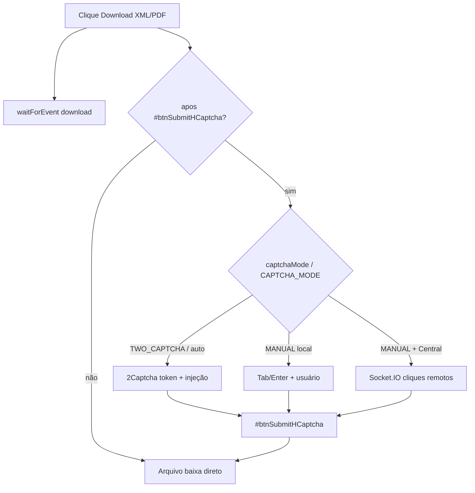

# 06 — CAPTCHA e navegador

Acoplamento entre Chromium Playwright e hCaptcha no download de notas.

## Diagrama

## Browser

| Aspecto | Realidade | Evidência |
|---------|-----------|-----------|
| Engine | Chromium Playwright | `playwright-nfse.ts` `chromium.launch` L90–93 |
| Perfil persistente | Não | Sem `launchPersistentContext` / userDataDir |
| Headless | Settings + override MANUAL=false | `execution-service.ts` L211–216; `playwright-config.ts` |
| Viewport / slots | Layout visual opcional | `captcha-window-manager.ts` + `CAPTCHA_WINDOW_LAYOUT_ENABLED` |
| Args | Download bubble off, sandbox container opcional | `playwright-config.ts` L57–66, `appendContainerChromiumArgs` |

Login A1 **não** resolve hCaptcha no código de `playwright-nfse.ts`.

## Detecção de CAPTCHA

| Evidência | Detalhe |
|-----------|---------|
| Arquivo / Constante / Linhas / Evidência | `download-operation.ts` / `CAPTCHA_SUBMIT_SELECTOR` / L46 / `#btnSubmitHCaptcha` |
| Arquivo / Função / Linhas / Evidência | `tentarResolverCaptchaSeNecessario` / L497–517 / race: modal visível vs download já disparado |
| Arquivo / Constante / Linhas / Evidência | Cancelamento: `#btnLimpar` L47; timeouts detect 8s L49 |

## Modos

### Modo do lote (UI)

| Valor | Comportamento | Evidência |
|-------|---------------|-----------|
| `TWO_CAPTCHA` | Resolve via provider 2Captcha | `captcha/types.ts` L6; `download-operation.ts` L552–565 |
| `MANUAL` | Browser visível; Tab/Enter ou Central | `execution-service.ts` L211–216; `download-operation.ts` L523–543 |

### Modo ambiente (`CAPTCHA_MODE`)

| Valor | Significado | Evidência |
|-------|-------------|-----------|
| `auto` | Só 2Captcha | `config.ts` L103–111 |
| `manual` | Só manual | idem |
| `auto_manual` (default) | 2Captcha com fallback manual | idem |

Central remota: `CAPTCHA_MANUAL_USE_CENTRAL=true` + `captchaMode=MANUAL` + `batchId` (`processar-notas-competencia.ts` L558–564; `config.ts` L132–133).

## Timeouts (config)

| Constante | Default tipico | Evidência |
|-----------|----------------|-----------|
| `CAPTCHA_SOLVE_TIMEOUT_MS` | 420000 (7 min) | `config.ts` L86–88 |
| `CAPTCHA_MANUAL_TIMEOUT_MS` | 420000 | L114–116 |
| `MANUAL_CAPTCHA_TIMEOUT_MS` | 120000 (Central) | L123–125 |
| Download buffer pós-captcha | +60000 | `download-operation.ts` L50 |

Retry de operação (fecha modal, regenera desafio): `CAPTCHA_OPERATION_MAX_ATTEMPTS` e delay em `config` + loop em `executarDownloadNotaComRetry`.

## Onde o CAPTCHA está acoplado

| Etapa | CAPTCHA? |
|-------|----------|
| Login A1 | Não (NÃO IDENTIFICADO no fluxo A1) |
| Login credencial | NÃO IDENTIFICADO NO CÓDIGO como hCaptcha (fluxo separado em `login-credencial-nfse.ts`) |
| Navegação menus / filtro datas | Não |
| Clique Download XML/PDF | **Sim** — único ponto com `#btnSubmitHCaptcha` |

## Se existir API oficial

Quase todo o pipeline UI deixa de ser necessário:

- Chromium, slots visuais, zoom, menus `li:nth-of-type`
- Tabelas DOM, paginação, heurística de chave
- hCaptcha, 2Captcha, Central Socket.IO, fallback manual
- `download-operation` / evento `download`

Permanecem úteis (adaptáveis): loader PFX+senha, organização de pastas, logging, eventual fila single-company.

Detalhes de reuso: [09-COMPONENTES-REUTILIZAVEIS.md](./09-COMPONENTES-REUTILIZAVEIS.md).
