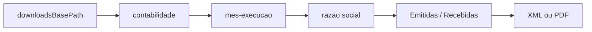

# 07 — Armazenamento XML

Hierarquia real de arquivos, naming, idempotência e ausência de parser/DB de notas.

## Hierarquia real (código de save)

```text
{downloadsBasePath}/
  {nomeContabilidade}/
    {mes_extenso}-{ano}/          ← mês da EXECUÇÃO (ex.: outubro-2026)
      {razaoSocialEmpresa}/       ← sanitizado; fallback CNPJ se sem razão social
        Emitidas/                 ou Recebidas/
          {arquivo}.xml|.pdf
```

| Evidência | Detalhe |
|-----------|---------|
| Arquivo / Função / Linhas / Evidência | `download-manager.ts` / `montarCaminhoCompleto` / L155–171 / `path.join(base, contab, mesExecucaoExtenso, empresa, tipo)` |
| Arquivo / Função / Linhas / Evidência | `formatarMesExecucaoParaPasta` / L51–54 / `"janeiro-2026"` etc.; comentário L48–49: **não** é competência da nota |
| Arquivo / Função / Linhas / Evidência | `execution-service.ts` / L786–793 / `agora = new Date()` → mês atual; `nomeContabilidade` da empresa; `nomeEmpresa` = razão social |
| Arquivo / Função / Linhas / Evidência | `salvarDownloadDireto` / L178–197 / `mkdir` + `download.saveAs` |



## Divergência: `downloadsPattern`

| Camada | Pattern | Usado no save? |
|--------|---------|----------------|
| Settings DB / UI | default `{cnpj}/{ano}/{mes}` | **Não** no `salvarDownloadDireto` |
| Preview | `POST /api/settings/test-paths` | Apenas preview | 

| Evidência | Detalhe |
|-----------|---------|
| Arquivo / Model / Linhas / Evidência | `schema.prisma` / `Settings.downloadsPattern` / L108 |
| Arquivo / Rota / Linhas / Evidência | `routers/settings.ts` / `test-paths` / L294–301 / `resolveDownloadsPattern` |
| Uso de `downloadsPattern` em `montarCaminhoCompleto` / `salvarDownloadDireto` | **NÃO IDENTIFICADO NO CÓDIGO** |

Documentar como divergência evidenciada: organização “por CNPJ/ano/mês” é configuração/preview, **não** o path real de download.

## Naming de arquivos

| Evidência | Detalhe |
|-----------|---------|
| Arquivo / Função / Linhas / Evidência | `gerarNomeArquivo` / L124–146 / prioriza `download.suggestedFilename()`; senão `prefixo` ou `nota_{timestamp}` |
| Arquivo / Função / Linhas / Evidência | `baixarArquivosDaLinha` / L538–539 / prefixo = `numeroNota_` se heurística achou número |
| Arquivo / Função / Linhas / Evidência | `detectarExtensaoArquivo` / L88–118 / URL/magic bytes → `.xml` / `.pdf` / `.bin` |

## Validação e skip (idempotência FS)

| Evidência | Detalhe |
|-----------|---------|
| Arquivo / Função / Linhas / Evidência | `validarArquivoBaixado` / L210–246 / tamanho >0; XML começa com `<`/`<?xml` e não HTML; PDF `%PDF` |
| Arquivo / Função / Linhas / Evidência | `localizarArquivoExistenteValido` / L262–291 / mesma pasta + extensão + prefixo parcial |
| Arquivo / Função / Evidência | `executarDownloadNotaComRetry` — se arquivo válido existe, pula download (stage `download_completed` com mensagem de skip; ver L701–702 em leitura prévia) |

## Ausências

| Item | Status |
|------|--------|
| Empacotamento ZIP do lote | NÃO IDENTIFICADO NO CÓDIGO |
| Parser XML fiscal (chave, CNPJs, valor, competência) | NÃO IDENTIFICADO NO CÓDIGO |
| Tabela Prisma de nota / chave | NÃO IDENTIFICADO — só `qtdNotasEmitidas/Recebidas` |
| Indexação da chave 44 no nome do arquivo | Parcial: chave usada para **retry/localização na UI**, não necessariamente no filename (filename vem do portal/`suggestedFilename`) |

## Implicações para reconciliação POC

1. Comparar pastas AutoNacional vs POC exige mapear **razão social + mês de execução**, não `{cnpj}/{ano}/{mes}` do setting.
2. Chave 44 está confiável no fluxo DOM (`extrairIdentificadorDaLinha`); no FS depende do nome sugerido pelo portal.
3. Sem índice DB, reconciliação = varrer filesystem (+ opcionalmente parsear XML na POC).
4. Competência fiscal da nota **não** define a pasta — risco se a execução rodar em mês diferente do filtro de datas.
