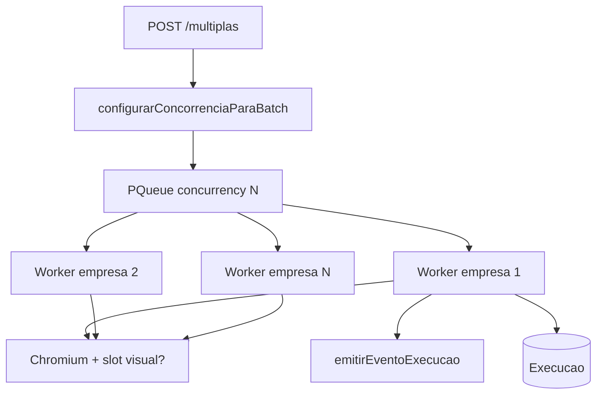

# 08 — Filas e concorrência

Orquestração in-process com `p-queue`, progresso SSE e limites de retry.

## Modelo

## PQueue

| Evidência | Detalhe |
|-----------|---------|
| Arquivo / Constante / Linhas / Evidência | `execution-service.ts` / `fila` / L363–366 / `new PQueue({ concurrency: 3, autoStart: true })` |
| Arquivo / Função / Linhas / Evidência | `adicionarExecucao` / L256–273 / `fila.add(async () => executarFluxoCompleto(...))` |
| Arquivo / Função / Linhas / Evidência | `configurarConcorrenciaParaBatch` / L137–159 / `concurrencyFinal = min(defaultConcurrentBrowsers, maxConcurrentBrowsers, visualSlots?, totalEmpresas)` |
| Arquivo / Settings / Evidência | `schema.prisma` `Settings` L101–102 / defaults 5 max / 3 default |

Estado da fila exposto em `/health` via `obterEstadoFila` (L368–377: `pending`, `running`, `shuttingDown`).

## Slots visuais

Quando `CAPTCHA_WINDOW_LAYOUT_ENABLED` e não-headless: `captchaWindowManager.reserveSlot` antes do launch (`execution-service.ts` L675–691); liberação em `finalizarExecucao` após fechar browser (L551–556).

## Progresso (SSE)

| Evento típico | Quando | Evidência |
|---------------|--------|-----------|
| `execution:started` | Início worker | L606–612 |
| `execution:stage` | abrir_navegador, login, baixar_*, captcha_* | vários pontos L654+ |
| `execution:counts` | Após emitidas/recebidas | L867–873, L944–950 |
| `execution:finished` | Finalização | `finalizarExecucao` L516–525 |

Canal HTTP: `GET /api/execucao/stream/:batch_id` (`routers/execucao.ts`).

## Resultados de negócio

| Código | Condição | Evidência |
|--------|----------|-----------|
| `SEM_MOVIMENTO` | 0 emitidas e 0 recebidas | L953–960 |
| `NOTAS_EMITIDAS` | só emitidas >0 | |
| `NOTAS_RECEBIDAS` | só recebidas >0 | |
| `NFS_ENCONTRADAS` | ambas >0 | |
| `ERRO` | falha | catch / finalize |

Constantes listadas em L57–62.

## Retry

| Nível | O quê | O que não faz |
|-------|-------|---------------|
| Download/CAPTCHA | Nova tentativa de operação: fecha `#btnLimpar`, relocaliza nota, nova task 2Captcha | Não reutiliza token/taskId anterior (`download-operation.ts` cabeçalho L1–6) |
| Navegação `goto` | Retry ERR_ABORTED/timeout | `playwright-nav.ts` `gotoWithRetry` |
| Arquivo inválido | Remove + retry operação | `removerArquivoInvalido` |
| Job de empresa | — | **Sem** re-enfileiramento automático pós-crash |
| Lote | — | **Sem** resume de batch; só skip se arquivo já válido no FS |

Falhas consecutivas de captcha automático: `CAPTCHA_CONSECUTIVE_FAILURE_LIMIT` + `shouldSkipAutoForExecution` (`download-operation.ts` L80–91).

## Ausências

| Item | Status |
|------|--------|
| Cron / agendamento periódico | NÃO IDENTIFICADO NO CÓDIGO |
| Redis / Bull / worker externo | NÃO IDENTIFICADO NO CÓDIGO |
| Persistência da fila entre restarts | Em memória (`execucoesAtivas` Map) — jobs pendentes marcados falha em `pararFilaExecucao` L384–407 |
| Resume de job do ponto da nota N | NÃO IDENTIFICADO — apenas `localizarArquivoExistenteValido` |

## Encerramento gracioso

| Evidência | Detalhe |
|-----------|---------|
| Arquivo / Função / Linhas / Evidência | `pararFilaExecucao` / L384–427 / `encerrandoFila=true`, `fila.pause/clear`, fecha browsers, espera `onIdle` com timeout |
