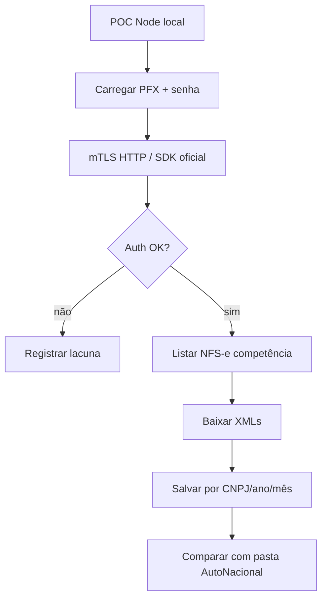

# 10 — Plano POC API (protocolo futuro)

Protocolo **não executado** nesta auditoria. Serve para validar, em repositório independente, se autenticação A1 + API oficial (ADN/Emissor) substituem a automação Playwright do AutoNacional.

## Cenário-alvo

| Parâmetro | Valor |
|-----------|-------|
| Ambiente | macOS local |
| Runtime | Node ≥18 |
| Escopo | 1 empresa |
| Auth | Certificado A1 (PFX) |
| Volume | >150 NFS-e no mês |
| Dependência AutoNacional | Nenhuma em runtime (só comparação de pastas de referência, se houver) |

## Contexto oficial (fora do repo)

URLs/documentação ADN e Emissor Nacional devem ser consultadas **no momento da POC** em fontes oficiais do governo. Neste repositório AutoNacional **não há** cliente ADN — ver `05-ENDPOINTS-HTTP.md`.

Não embutir credenciais, tokens ou PFX neste plano.

## Testes A–H (protocolo)

Cada teste: pré-condição → passos → critério de sucesso → evidência a guardar (logs, contagens, paths). **Não executar agora.**

### Teste A — Ambiente e certificado

- Pré: Node ≥18; PFX válido; senha; clock do SO correto.
- Passos: carregar PFX em memória; validar CNPJ do cert (opcional `node-forge`); não logar passphrase.
- Sucesso: buffer PFX + senha disponíveis sem Playwright.

### Teste B — Handshake mTLS HTTP

- Pré: A OK; endpoint oficial de auth/ping documentado.
- Passos: cliente HTTPS com client cert (Agent/`undici`/SDK); sem browser.
- Sucesso: HTTP 2xx autenticado.  
- Falha esperável: se só o caminho browser for aceito — registrar como bloqueador (lacuna já prevista em `03`/`11`).

### Teste C — Autorização da empresa

- Pré: B OK.
- Passos: chamar operação que liste contribuinte/empresa vinculada ao A1.
- Sucesso: CNPJ da POC corresponde ao certificado.

### Teste D — Listagem >150 notas

- Pré: competência com volume conhecido (>150).
- Passos: listar emitidas e/ou recebidas via API; paginar se necessário.
- Sucesso: contagem API ≥ 150 (ou igual à referência UI).

### Teste E — Download XML em lote

- Pré: D OK.
- Passos: baixar XMLs; gravar em `{cnpj}/{ano}/{mes}/Emitidas|Recebidas/` (recomendado para POC).
- Sucesso: N arquivos XML válidos (assinatura `<`/`<?xml`); zero HTML de erro.

### Teste F — Metadados / chave 44

- Pré: E OK.
- Passos: parsear XML (novo código) extraindo chave 44; indexar.
- Sucesso: 100% das notas com chave única; sem colisões.

### Teste G — Comparação com AutoNacional

- Pré: pasta gerada pela automação atual (mesmo período), se disponível.
- Passos: cruzar chaves (API vs DOM/FS); notar divergência de path (razão social/mês execução vs CNPJ/competência).
- Sucesso: cobertura ≥ limiar acordado (ex.: 98% das chaves); divergências listadas.

### Teste H — Ausência de CAPTCHA/browser

- Pré: E–G OK.
- Passos: confirmar que a POC não lançou Chromium nem chamou 2Captcha.
- Sucesso: zero processos Playwright; zero requests a `api.2captcha.com`.

## Critérios de comparação com pastas atuais

| Dimensão | AutoNacional atual | POC sugerida |
|----------|--------------------|--------------|
| Path | `{contab}/{mês-execução}/{razão}/{tipo}/` | `{cnpj}/{ano}/{mes}/{tipo}/` |
| Índice | Contagens + FS | Chave 44 + FS (+ DB opcional) |
| Auth | Playwright mTLS | HTTP mTLS / SDK |
| CAPTCHA | Sim no download UI | Não (meta H) |

## Fora de escopo desta auditoria

- Implementar a POC
- Alterar AutoNacional
- Chamar ADN/Emissor de verdade
- Abrir browser ou tocar certificados de produção neste trabalho
